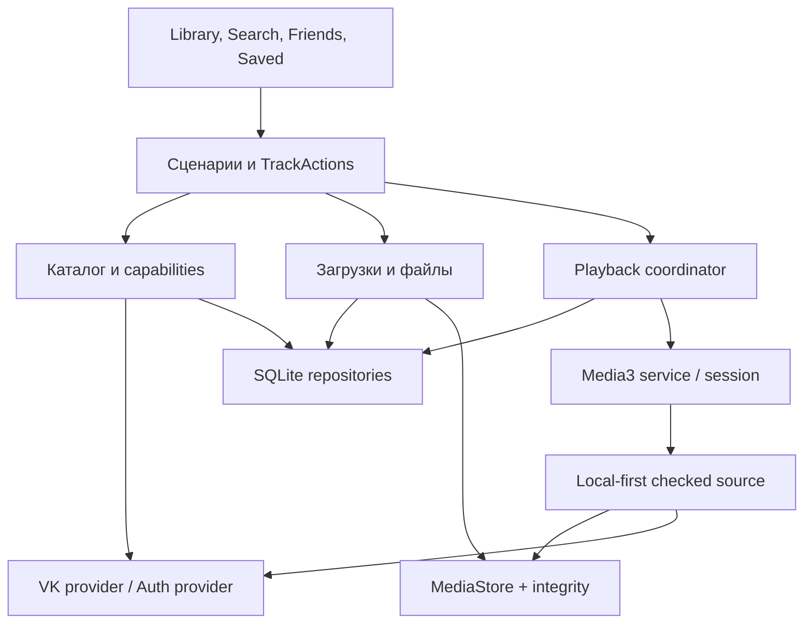

# Архитектура будущего музыкального клиента

## Принцип перехода

Сохранить рабочее export/file integrity ядро, постоянную подпись, существующие task keys и библиотеку. Разделить domain модели музыки, пользовательские намерения, provider capabilities и системных владельцев операций. Начать с границ в одном модуле; физические Gradle-модули добавлять по мере пользы для сборки и изоляции, а не ради схемы.

UI не должен передавать токены, signed URLs и конкретные store instances между экранами. ViewModels — состояние экрана/действия, use cases — бизнес-проверки, repositories — источники данных и транзакции. Application scopes владеют долгими задачами, screen scopes — отменяемыми чтениями. Мутации и чувствительные file edits используют общий проверенный lease и сериализацию, а не произвольные флаги UI busy.

## Локальная модель

| Сущность | Основные поля/индексы | Что сохраняет |
|---|---|---|
| Account | provider, accountId, session generation; уникальный provider/accountId | Изоляция удалённых данных; секреты отдельно в vault |
| Track | provider/remoteId, title/subtitle/artist, duration, restriction/version, fetchedAt | Канонические метаданные без URL; ключ provider+remoteId |
| Collection | provider/account/source kind/remote key, title, completeness/version | Локально открываемый album/playlist snapshot |
| Membership | collection key, remote track key, occurrence, ordinal | Порядок и повторные вхождения; индекс collection+ordinal |
| LocalAudio | localFileId, canonical URI, bytes/hash, format/duration, integrity revision | Один физический файл, много membership ссылок; уникальность URI |
| TrackLocalLink | track/source/account ↔ localFileId, catalogueVerified | Происхождение и доверие; ручная замена не становится оригиналом |
| DownloadTask / attempts | stable key, source/occurrence, state, error/detail, optional partial checkpoint | Устойчивая очередь, адресный retry; сохранить текущие ключи |
| PlaybackQueue / item | queueId, ordered IDs, source/account, occurrence, current index/position, shuffle seed/repeat | Восстановление без токенов/подписанных ссылок |
| MaintenanceTargets / cursor / issues | runId, account/stage, indexed targets; next/results отдельно | O(N) запись вместо полной сериализации каждого шага |
| Receipt | account, exact track metadata fingerprint, codec/signature version, sha, created/expiry | Дубликаты без durable audio и без consent |
| Capability / query cache | session/account/providerVersion + capability; q/page keys, freshness | Явные supported/experimental/denied/unknown, cache expiry |

Не обязательно сразу вводить Room: текущий SQLite можно развить через DAO/repository и additive schema v4+. Room полезен для типизированных запросов/миграций, но не исправит JSON-N+1 автоматически. Для поиска своей/сохранённой музыки рассмотреть FTS с Unicode/нормализацией и измерениями; remote search — отдельная provider capability. Полнотекстовые таблицы не должны удалять основную библиотеку при rebuild индекса.

## Воспроизведение

Сервис остаётся единственным владельцем player/MediaSession. UI подключается через MediaController/coordinator, а не через публичную ссылку на Service. Playback queue хранит identity/occurrence, локальный URI выбирается при подтверждённой пригодности, иначе online resolve только с правильным account/read lease. Метаданные и queue UI доступны после restart даже offline. Реализовать onPlaybackResumption/MediaButtonReceiver согласно Media3, не запускать музыку самопроизвольно при обычном старте приложения.

Audio focus и becoming-noisy уже настроены; подтвердить звонки, другой player, BT/headset, lockscreen и media buttons на реальных устройствах. Для cache согласовать бюджет/eviction и account/source key; ExoPlayer streaming buffer и публичный offline file — разные ресурсы. Prefetch ограничить числом/байтами, учитывать мобильную сеть, rate limits и отмену. Устойчивый playback state не должен включать secret URL.

Все каталоги используют одну TrackActions модель: play now/from index, play next/append queue, download, сведения, разрешённая mutation. Действия строятся по capabilities, состоянию конкретного трека и текущей очереди. Сортировка экрана не меняет source occurrence/key. Скачанный альбом остаётся видимым, remote deletion не удаляет local snapshot без отдельного решения пользователя.

## Авторизация и провайдер

AuthProvider отделён от VkMusicProvider. Официальный VK ID интегрировать только по актуальной документации собственного приложения, с предусмотренными SDK защитами callback/state/PKCE; факт авторизации не активирует музыкальные capabilities автоматически. Экспериментальный текущий WEB adapter, если используется, имеет собственную версию и диагностический compatibility статус, не маскируется под публичный API. Не подставлять рекомендации или guessed IDs вместо недоступных разделов.

Ошибки типизированы: account auth, scoped denial, challenge, rate limit/retry time, transient transport, unsupported contract, malformed response, partial catalog и changed resource. Повторы централизованы и ограничены; mutation не replay автоматически. Пользователь должен видеть полезное действие, а технические коды доступны в подробностях.

## Миграция и системная работа

До schema migration сделать проверяемую локальную копию приватной БД/журналов без потери Keystore связи; не переносить secret envelope в отчёт. На upgrade — additive tables/indexes, заполнение в контролируемых транзакциях, old IDs/URI/source keys сохраняются. Никакого destructive fallback, удаления MediaStore, смены applicationId или signing key. Проверить kill/ENOSPC/rollback на каждом этапе и повторный запуск.

API29–33: разрешённый пользовательским действием dataSync FGS для экспорта; API34+: UIDT. Maintenance использует dataSync FGS и учитывает onTimeout/6h budget на API35+ при target35+. Playback отдельно mediaPlayback. Не объединять все задачи в один FGS type и не считать dataSync бессрочным. На API37 текущее приложение тестируется с target36; переход target37 потребует отдельной проверки актуальных behavior changes.
