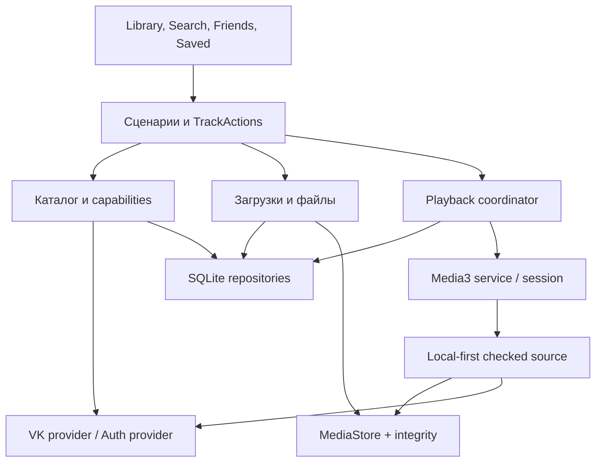

# VK Music Export — технический аудит и план преобразования

Версия отчёта: 4 ноября 2026. Код не изменён.

## Содержание

01. Executive Summary
02. Фактическая архитектура
03. Полный реестр выявленных проблем
04. Производительность: измерения, стоимость алгоритмов и пределы вывода
05. Безопасность
06. VK API, авторизация и границы интеграции
07. UX-аудит всех текущих экранов и состояний
08. GitHub Actions, тесты и релизная цепочка
09. Архитектура будущего музыкального клиента
10. План исправлений, зависимости, трудоёмкость и риски
11. Уже реализовано: сохранить при преобразовании
12. Методика, покрытие и открытые проверки

# Executive Summary

Аудит VK Music Export выполнен для `main` на **4 ноября 2026 года, МСК**. Исходный коммит: **`90e6848257e93d82b3a6b8af09cc58ef067a7703`**. Коммит датирован 3 ноября 2026 года, 18:36:34 МСК. Latest: **v0.12.1-build.1433**, опубликован 3 ноября, 18:54:39 МСК; SHA-256 APK: `3dac4905703c990d53a431b54cfd01ce12389db439943165d7a99ac30f6e3889`.

Это уже не минимальный экспортёр: реализованы Media3/ExoPlayer, MediaSession, онлайн- и офлайн-воспроизведение, собственная устойчивая очередь экспорта, музыка друзей, каталоги, обложки, исправление метаданных, точное сравнение дубликатов и безопасные механизмы миграции. Переписывать приложение с нуля не требуется.

Для ежедневного музыкального клиента не хватает устойчивого playback state, единого действия трека во всех каталогах, глобального поиска и локальной модели подборок. Наиболее серьёзные технические вопросы: окно смены read session (F01), расходящиеся Latest/канал обновлений (F02), отсутствие фактической защиты main (F03) и квадратичная запись большого metadata run (F07). Основной внешний риск — неподдерживаемый музыкальный/WEB auth протокол, а не Compose или Android 10.

В реестре **30 записей**: 7 P1, 19 P2 и 4 P3. Записи включают дефекты, известные компромиссы экспортёра, продуктовые разрывы относительно нового ТЗ и недостаток доказательств. Они не выдаются за 30 воспроизведённых падений. **Подтверждённых P0 не найдено** в доступном объёме проверки; это не сертификат отсутствия уязвимостей.

Локально прошли 85 Python-тестов, проверка синтаксиса 7 shell-скриптов, XML/JSON и серверные SQLite/JSON микрозамеры на 100/4500/20000 записей. Android Gradle-задачи локально не стартовали: загрузка Gradle 9.8.2 завершилась `Network is unreachable`; SDK/adb/эмулятор также не обнаружены. Разрешённый VK-тестовый аккаунт не предоставлялся и не использовался.

Независимо получены логи CI **того же SHA**: JVM debug task, Lint debug/release, release R8, OSV (217 компонентов, без findings в момент CI) и **144 instrumented tests без failures/skips на каждом API 29–37**. Signed upgrade с двух APK baseline на API36 успешен по CI. Это выполненные GitHub Actions проверки 3 ноября, не новый локальный Android-запуск. Ручная acceptance остаётся `pending`; это явно отражено в owner-requested выпуске.

`main`, исходники, правила репозитория, workflows и релизы не изменялись. Новые отчёты, диагностические скрипты и предложенный regression test находятся вне checkout. Проценты готовности не присваиваются.

---

# Фактическая архитектура

Один Gradle-модуль `:app`, общий package music, ручное создание зависимостей и process-singletons. Есть отдельные протоколы/чистые функции и service owners; полного UI/domain/data-разделения нет. Kotlin main: 98 файлов, 12371 строк, 852244 байта. Всего 175 Kotlin-файлов: 98 main, 41 unit, 36 androidTest.

| Класс / компоненты | Зависимости | Ответственность | Вход → выход |
|---|---|---|---|
| MainActivity / MusicApp | NativeMusicViewModel, UpdateViewModel, NativeMusicPanel | Вход, lifecycle, routing уведомлений | Intent/lifecycle → Compose root и foreground signals |
| NativeMusicViewModel | MusicApi, MusicSessionManager, vault, AudioExportRuntime, MaintenanceRuntime, FriendMusicController | Оркестрация музыкального UI и операций | Действия пользователя → StateFlow/запуски операций; 1414 строк |
| FriendMusicController | MusicApi, sessions/vault, coroutine scope, export runtime | Друзья, статусы, профили и подготовка выбора | Аккаунт/друг/выбор → FriendMusicState и export tasks |
| VkDeviceAuthClient / VkWebTokenExchange | OkHttp, DeviceAuthProtocol, WebExchangeProtocol, PairingCookieJar | Экспериментальный WEB pairing и обмен | Одноразовая заявка/код → проверяемый MusicAccess; это не VK ID SDK |
| MusicAccessStore | Android Keystore, AES/GCM, AtomicFile, MusicCredentialCodec | Зашифрованный доступ и материал продления | MusicAccess ↔ noBackupFilesDir/native-music-access.bin |
| MusicSessionManager | MusicCredentialStore, MusicRenewer, verify, Mutex | Продление/CAS/границы read session | Старый access/ответ ошибки → текущий проверенный access или отказ |
| VkAudioClient : MusicApi | OkHttp, sessions, NativeProtocol, MusicApiPacer | Фиксированные методы, POST, parsing/error policy | Access+метод+параметры → typed DTO; signed URL только в памяти |
| MusicPagination / MusicCatalog / MusicArtists | MusicApi/fetch callbacks и protocol DTO | Полнота страниц, типы списков, subscriptions layout | Страницы offset/cursor → NativePage/NativeCatalog/artist list |
| AudioExportRuntime | AudioExportStore, AudioExportEngine, Mutex, readiness, transport | Единый coordinator экспорта и edits | Tasks/start/pause → ExportSnapshot; singleton process lifetime |
| BackgroundTransport | JobScheduler либо ContextCompat FGS | Выбор Android механизма | API29–33 → Legacy services; API34+ → UIDT jobs |
| AudioExportJob / LegacyAudioExportService | AudioExportRuntime, notification/service lifecycle | Фоновое владение экспортом | Задание системы → run/остановка/checkpoint без самовольного restart |
| AudioExportEngine | Store, SharedAudioStore, MusicApi, AudioTransfer, SavedAudioReuse, DownloadArtwork | Восстановление, claim, download/retry, publish, M3U8 | PENDING task → DONE/FAILED/PAUSED и MediaStore запись |
| AudioTransfer / HlsPlaylist | OkHttp media client, allowlist, AndroidAudioProcessor, AES-128 subset | Передача finite VOD и обработка разрешённого формата | Свежий URL/NativeTrack → staging TransferResult; не универсальный HLS/CAS |
| AndroidAudioProcessor / EmbeddedArtwork | Media3 extractors, MediaMuxer, MP3/MP4 parsing | MP3 pass/remux AAC→M4A, теги и подпись аудиоданных | Staging input → MP3/M4A и duration/fingerprint |
| AudioExportStore | SQLiteOpenHelper v3, WAL/FULL, Kotlin serialization | Tasks, files/memberships, meta, directories, source failures | DTO ↔ SQLite; JSON payload не является нормализованным музыкальным каталогом |
| SharedAudioStore / SharedPlaylistStore | ContentResolver, MediaStore, hash, store | Владение/целостность/pending и переносимый M3U8 | Проверенный staging/URI → опубликованный файл + индексный checkpoint |
| SavedAudioReuse / SavedFileRecovery / LegacyArchiveMigration / FriendFolderMigration | Store, shared audio/playlists, AtomicFile/journals | Повторное использование и миграции | Старые/перемещённые записи → подтверждённые новые ссылки без удаления оригиналов |
| TrackMetadataRepair / ArtworkRepair | Store, shared audio, durable backup, EmbeddedArtwork | Транзакционное изменение существующего файла | Подтверждённый before → verified after либо rollback |
| MaintenanceRuntime / MaintenanceService | AtomicFile targets/progress, wakelock, notifications, supplied operation | Долгие операции с файлами вне Activity scope | Start/resume/pause → persistent cursor и reports |
| MusicDuplicates / DuplicateAudioHasher / DuplicateScanCache | MusicApi, transfer/local file, fingerprints, AtomicFile | Поиск точных дублей и одноразовое удаление | Library → candidates/signatures/report; consent → одна проверенная mutation |
| MusicPlaybackService / PlaybackRuntime | ExoPlayer, MediaSession, MusicSessions, API, ArtworkLoader | Единственный player и process-memory playback state | PlaybackSelection → media session, mini/full-player StateFlow |
| PlaybackMediaSource / PlaybackDataSources / PlaybackNetwork | Media3 source factory, OkHttp, allowlist, content URI checks | Ленивое разрешение URL и защита media boundary | Opaque media ID → проверенный online/offline child source |
| UpdateController / GithubUpdates / UpdateProtocol | OkHttp, preferences, PackageManager, FileProvider | Публичный канал, APK download и проверка подписи | Manifest → available/verified APK → системный installer Intent |
| Diagnostics / RunJournal / Privacy | Bounded queue, async disk, NDJSON, FileProvider | Ограниченная диагностика без auth/media secrets | Fixed event fields → текущий/предыдущий JSON по явному share |

## Границы и владение

UI получает StateFlow, но также непосредственно обращается к PlaybackRuntime и использует Android Context. ViewModel создаёт конкретные stores и maintenance use cases. Export engine сохраняет каждый готовый item; playback queue к этому механизму не относится. Singleton MusicSessions объединяет обновления токена, vault имеет собственный synchronized lock. Разные SQLiteOpenHelper экземпляры обслуживают одну БД; SQLite-транзакции, runtime controls и гейты решают разные задачи и не должны считаться одной общей блокировкой.

Существуют SupervisorJob scopes приложения/сервисов, viewModelScope и compose scopes. В сетевом withResponse cancellation отменяет настоящий OkHttp Call; большинство бизнес-путей пробрасывает CancellationException. Mutex/CAS вокруг refresh защищает от многих поздних результатов; F01 описывает отдельный непокрытый промежуток request(). MaintenanceRuntime умышленно продолжает операцию после Activity/ViewModel, это само по себе не memory leak. Утечка Activity heap dump не проверялась.

В `appendix/architecture-lexical.json/.tsv` перечислены обнаруженные объявления классов/interfaces/objects с точными файлами/строками и ссылками на символы того же файла; `function-signatures.json` сохраняет сигнатурные строки. Это лексическая карта покрытия, **не compiler call graph и не доказанные зависимости каждого вложенного класса**. Таблица выше — вручную прослеженные зависимости ключевых путей. Для точного compiler graph нужна успешная Gradle/Kotlin сборка.

---

# Полный реестр выявленных проблем

P0 — немедленный критический ущерб; P1 — до публичного запуска нового клиента; P2 — плановое устранение/реализация; P3 — сопровождение и полировка. Недостающая возможность относительно нового ТЗ не называется доказанной аварией текущего экспортёра.

Всего: P0: 0, P1: 7, P2: 19, P3: 4.

| ID | Приоритет | Тип | Проблема |
|---|---|---|---|
| F01 | P1 | Гонка / граница аккаунта | request() допускает подстановку новой независимой сессии между двумя чтениями |
| F02 | P1 | Релизная цепочка | Встроенный канал отстаёт от GitHub Latest |
| F03 | P1 | Защита репозитория | main фактически не защищён подготовленным ruleset |
| F04 | P1 | Риск платформы / prerequisite | Музыкальное ядро и вход зависят от внутреннего протокола и чужих client ID |
| F05 | P1 | Пробел в приёмке | Stable опубликован с неподтверждённой ручной приёмкой реального сценария |
| F06 | P1 | Недостающая возможность клиента | Очередь, позиция и режимы прослушивания не переживают смерть процесса |
| F07 | P1 | Производительность хранения | Курсор метаданных переписывает весь снимок целей после каждого файла |
| F08 | P2 | Производительность хранения | Кэш дубликатов полностью сериализуется после каждого нового receipt |
| F09 | P2 | SQLite / N+1 | snapshot() загружает все ошибки и делает отдельный meta-запрос для каждой |
| F10 | P2 | SQLite / масштабирование | Поиск алиасов URI и обновление ссылок читают весь индекс |
| F11 | P2 | MediaStore / старт экрана | Обновление «Сохранённого» делает по несколько provider-запросов на каждый файл |
| F12 | P2 | Coroutine lifecycle | pauseRead() не отменяет проверки доступности друзей |
| F13 | P2 | Запросы / latency | Открытие подборки и скачивание одной песни повторно читают большие списки |
| F14 | P2 | UX / несоответствие будущему клиенту | Полностью скачанные подборки исчезают из библиотеки |
| F15 | P2 | Недостающая возможность | Нет отдельного глобального музыкального поиска и рекомендаций |
| F16 | P2 | UX / недостающая связность | Треки исполнителя отображаются без воспроизведения и скачивания |
| F17 | P2 | UX / недостающая связность | Собственные онлайн-треки не запускаются нажатием, а плеер не получает download task |
| F18 | P2 | Навигация | Самостоятельный экран загрузок есть в коде, но не достижим штатным выбором |
| F19 | P2 | Известное ограничение | Незавершённый большой файл после остановки загружается с начала |
| F20 | P2 | Доступность входа | Вход жёстко требует пакет Google Chrome |
| F21 | P2 | Корректность ошибки | Код VK 201 без дополнительных данных приписывается приватности друга |
| F22 | P2 | Логика сессии / UX | Ручной поиск обложки привязан к credentialId и не переносит штатное продление |
| F23 | P2 | Проверка доступности / UX | TalkBack, крупный текст и семантика музыкальных действий не подтверждены |
| F24 | P2 | Пробел тестирования | Нет доказательств Macrobenchmark, нагрузочной Android-библиотеки и R8 instrumented playback |
| F25 | P2 | Supply chain / полнота SCA | SBOM/OSV не охватывает всю цепочку сборки; SAST workflow отсутствует |
| F26 | P2 | Архитектурный долг | ViewModel объединяет слишком много независимых подсистем и общий busy gate |
| F27 | P3 | Долговечность доказательств | Полные доказательства релиза исчезают по retention CI |
| F28 | P3 | Документация | README и Android compatibility document содержат устаревшие инструкции |
| F29 | P3 | UX сортировки | Меню предлагает сортировки, которые для подборок не применяются |
| F30 | P3 | Мёртвые ветки / сопровождение | Старые UI-компоненты и ручная классификация остаются рядом с актуальным UX |

## F01 · P1 · request() допускает подстановку новой независимой сессии между двумя чтениями

**Код:** [app/src/main/java/app/alcovaibe/vkmusicexport/music/MusicSession.kt:188](https://github.com/alcovaibe/vk-music-export/blob/90e6848257e93d82b3a6b8af09cc58ef067a7703/app/src/main/java/app/alcovaibe/vkmusicexport/music/MusicSession.kt#L188), [app/src/main/java/app/alcovaibe/vkmusicexport/music/MusicSession.kt:202](https://github.com/alcovaibe/vk-music-export/blob/90e6848257e93d82b3a6b8af09cc58ef067a7703/app/src/main/java/app/alcovaibe/vkmusicexport/music/MusicSession.kt#L202).

**Статус доказательств:** Статически прослежена конкретная последовательность чтений. Регрессионный Kotlin-тест подготовлен отдельно, НЕ выполнен; ошибка не объявляется воспроизведённой на телефоне.

**Воспроизводимость / проверка:** Передать persisted-доступ A. Первое store.read() возвращает A; до чтения внутри current()/resolve() заменить хранилище на B с другим readSessionId. После current() block получает B. В приложении возможны параллельные UI, playback и фоновые чтения; сохранение ручного входа использует отдельную блокировку vault.

**Причина:** Проверка supplied/stored выполняется до current(), а полученный access повторно не сравнивается с supplied.readSessionId. Проверка continueRead() после resolve() есть, но этот путь request() её не использует.

**Последствия:** Чтение, начатое в сессии A, может отправиться с токеном B. Это нарушение изоляции запросов, а не доказанное удаление данных другого аккаунта: audio.delete идёт отдельным явным путём.

**Решение:** После разрешения текущего доступа проверить readSessionId и ожидаемый account ID до block; оформить общую выдачу read lease и сравнения для всех чтений. Не держать глобальный mutex на всё время сетевого запроса.

**Необходимые тесты:** В приложенном SessionRequestRaceProposedTest.kt заданы два последовательных результата store.read(). Дополнить A→B, A→новый вход A, logout, проверенное продление A→A. Убедиться, что block не вызывается для новой сессии.

## F02 · P1 · Встроенный канал отстаёт от GitHub Latest

**Код:** [docs/updates/android.json:7](https://github.com/alcovaibe/vk-music-export/blob/90e6848257e93d82b3a6b8af09cc58ef067a7703/docs/updates/android.json#L7), [app/src/main/java/app/alcovaibe/vkmusicexport/updates/UpdateProtocol.kt:16](https://github.com/alcovaibe/vk-music-export/blob/90e6848257e93d82b3a6b8af09cc58ef067a7703/app/src/main/java/app/alcovaibe/vkmusicexport/updates/UpdateProtocol.kt#L16), [tools/promote-owner-release.py:140](https://github.com/alcovaibe/vk-music-export/blob/90e6848257e93d82b3a6b8af09cc58ef067a7703/tools/promote-owner-release.py#L140).

**Статус доказательств:** Подтверждено актуальным GitHub API и кодом. Никакого обновления канала во время аудита не выполнялось.

**Воспроизводимость / проверка:** Сравнить pinned docs/updates/android.json (0.12.0, 1343) и GET releases/latest (v0.12.1-build.1433, тот же исходный SHA аудита). Установленный 1343 проверяет этот JSON и не обнаруживает 1433.

**Причина:** Документированный owner-requested путь публикует Latest, но сохраняет новый manifest только в release-output. Публикация канала остаётся отдельным незавершённым действием.

**Последствия:** Пользователи встроенного обновлятора не узнают о текущем Latest. Публикация APK и доставка информации об обновлении расходятся.

**Решение:** Завершать каждый выпуск проверенным PR канала либо явно учитывать отложенную публикацию; добавить проверку расхождения Latest и канала без автоматического слияния непроверенных данных.

**Необходимые тесты:** Контрактный тест обоих путей promotion: версия, minSdk, размер, SHA и digest вложения; внешняя проверка публичного JSON после завершения канала.

## F03 · P1 · main фактически не защищён подготовленным ruleset

**Код:** [.github/main-ruleset.json:4](https://github.com/alcovaibe/vk-music-export/blob/90e6848257e93d82b3a6b8af09cc58ef067a7703/.github/main-ruleset.json#L4), [CONTRIBUTING.md:216](https://github.com/alcovaibe/vk-music-export/blob/90e6848257e93d82b3a6b8af09cc58ef067a7703/CONTRIBUTING.md#L216).

**Статус доказательств:** Подтверждено API branches/main и пустым списком rulesets. Содержимое admin-only endpoint НЕ прочитано; права/настройки организации сверх этих ответов не проверены.

**Воспроизводимость / проверка:** GET branches/main возвращает protected=false и выключенную protection; GET rulesets возвращает []. Прямой branch-protection endpoint недоступен интеграции (403).

**Причина:** JSON ruleset в репозитории — проект конфигурации, а не применённое правило GitHub.

**Последствия:** Обязательность PR, ревью и build/interface не обеспечена серверным правилом. Неизменность main нельзя выводить из наличия JSON.

**Решение:** Администратору применить согласованные правила и проверить effective rules для main; решить вопрос второго ревьюера и аварийных исключений.

**Необходимые тесты:** Read-only проверка effective protection; в отдельном тестовом репозитории проверить запрет merge без checks, force-push и удаления.

## F04 · P1 · Музыкальное ядро и вход зависят от внутреннего протокола и чужих client ID

**Код:** [app/src/main/java/app/alcovaibe/vkmusicexport/music/DeviceAuth.kt:92](https://github.com/alcovaibe/vk-music-export/blob/90e6848257e93d82b3a6b8af09cc58ef067a7703/app/src/main/java/app/alcovaibe/vkmusicexport/music/DeviceAuth.kt#L92), [app/src/main/java/app/alcovaibe/vkmusicexport/music/DeviceTokenExchange.kt:48](https://github.com/alcovaibe/vk-music-export/blob/90e6848257e93d82b3a6b8af09cc58ef067a7703/app/src/main/java/app/alcovaibe/vkmusicexport/music/DeviceTokenExchange.kt#L48), [app/src/main/java/app/alcovaibe/vkmusicexport/music/NativeProtocol.kt:93](https://github.com/alcovaibe/vk-music-export/blob/90e6848257e93d82b3a6b8af09cc58ef067a7703/app/src/main/java/app/alcovaibe/vkmusicexport/music/NativeProtocol.kt#L93), [app/src/main/java/app/alcovaibe/vkmusicexport/music/VkAudioClient.kt:128](https://github.com/alcovaibe/vk-music-export/blob/90e6848257e93d82b3a6b8af09cc58ef067a7703/app/src/main/java/app/alcovaibe/vkmusicexport/music/VkAudioClient.kt#L128).

**Статус доказательств:** Зависимость подтверждена кодом. Работоспособность и разрешения реального VK-аккаунта НЕ проверялись. Публичная схема VKCOM на проверенном SHA не содержит audio/methods.json; это не доказательство отсутствия отдельных партнёрских соглашений.

**Воспроизводимость / проверка:** Проверить константы 7913379/6287487, auth.getAuthCode/checkAuthCode/validateAuthCode, login.vk.com web_token и фиксированные audio/catalog методы. В зависимостях нет официального VK ID SDK.

**Причина:** Используется экспериментальное WEB pairing и web-token exchange, а музыкальные методы не подтверждены как общедоступный контракт для собственного зарегистрированного приложения.

**Последствия:** Вход, музыка друзей, каталог и поиск могут перестать работать независимо от корректности Android-кода. Успешный вход/метод на одном токене не доказывает поддержку всей матрицы возможностей или право распространения аудио.

**Решение:** Выделить VkProvider и AuthProvider, capabilities по аккаунту/сессии, явно различать supported/experimental/unavailable. Проверить зарегистрированное приложение и разрешённую модель интеграции; отдельно оценить официальный VK ID без обещания, что он даст audio-доступ.

**Необходимые тесты:** Разрешённый тестовый аккаунт: отдельные проверки собственного списка, друга, поиска, карточки/альбома, URL, продления, отзыва, подписки/региона; фиксировать только обезличенные результаты по версии протокола.

## F05 · P1 · Stable опубликован с неподтверждённой ручной приёмкой реального сценария

**Код:** [docs/release-acceptance/current.json:2](https://github.com/alcovaibe/vk-music-export/blob/90e6848257e93d82b3a6b8af09cc58ef067a7703/docs/release-acceptance/current.json#L2), [tools/promote-owner-release.py:38](https://github.com/alcovaibe/vk-music-export/blob/90e6848257e93d82b3a6b8af09cc58ef067a7703/tools/promote-owner-release.py#L38), [.github/workflows/android.yml:305](https://github.com/alcovaibe/vk-music-export/blob/90e6848257e93d82b3a6b8af09cc58ef067a7703/.github/workflows/android.yml#L305).

**Статус доказательств:** Подтверждено current.json, журналом CI и notes релиза. Авторизация владельца в существующем пути признана; аудит ничего не публиковал.

**Воспроизводимость / проверка:** Сопоставить current.json=pending, release job 126026866925 и notes Latest: ручная приёмка не подтверждена, публикация сделана по отдельному запросу владельца.

**Причина:** Существуют два намеренно разных пути: обычный stable с exact-APK gate и ограниченное owner-requested продвижение при pending.

**Последствия:** Слово stable не означает проверку входа, 4449+ реальных записей, часа с погашенным экраном, сети и OEM. Нельзя использовать зелёную матрицу как замену этих результатов.

**Решение:** Для будущего клиента определить единый критерий стабильности. Если исключения сохраняются, отдельно отображать статус ручной приёмки и хранить точные результаты APK. Это не утверждение о несанкционированной публикации.

**Необходимые тесты:** Выполнить восемь обязательных сценариев из acceptance, плюс online/offline resumption, BT/audio focus и поиск. Каждый результат привязать к SHA, versionCode и SHA-256 APK.

## F06 · P1 · Очередь, позиция и режимы прослушивания не переживают смерть процесса

**Код:** [app/src/main/java/app/alcovaibe/vkmusicexport/music/MusicPlaybackService.kt:24](https://github.com/alcovaibe/vk-music-export/blob/90e6848257e93d82b3a6b8af09cc58ef067a7703/app/src/main/java/app/alcovaibe/vkmusicexport/music/MusicPlaybackService.kt#L24), [app/src/main/java/app/alcovaibe/vkmusicexport/music/MusicPlaybackService.kt:150](https://github.com/alcovaibe/vk-music-export/blob/90e6848257e93d82b3a6b8af09cc58ef067a7703/app/src/main/java/app/alcovaibe/vkmusicexport/music/MusicPlaybackService.kt#L150), [app/src/main/java/app/alcovaibe/vkmusicexport/music/PlaybackModel.kt:32](https://github.com/alcovaibe/vk-music-export/blob/90e6848257e93d82b3a6b8af09cc58ef067a7703/app/src/main/java/app/alcovaibe/vkmusicexport/music/PlaybackModel.kt#L32), [app/src/main/AndroidManifest.xml:23](https://github.com/alcovaibe/vk-music-export/blob/90e6848257e93d82b3a6b8af09cc58ef067a7703/app/src/main/AndroidManifest.xml#L23).

**Статус доказательств:** Отсутствие persistence подтверждено кодом и PRIVACY.md. Сценарий настоящего убийства playback-процесса в этом окружении не запускался; это известное ограничение, а не регрессия обещанного экспортёра.

**Воспроизводимость / проверка:** Создать очередь, включить shuffle/repeat, перейти к середине записи, остановить процесс и открыть приложение. В новом процессе PlaybackRuntime создаёт пустой PlaybackState; устойчивой записи playback queue и callback resumption нет.

**Причина:** Состояние хранится в singleton/полях сервиса; MediaButtonReceiver и onPlaybackResumption не реализованы.

**Последствия:** Нельзя продолжить ежедневное прослушивание с прежнего места после выгрузки процесса/перезагрузки. Скачивания при этом имеют другую, устойчивую очередь — их нельзя путать.

**Решение:** Сохранить media IDs, источник/аккаунт, порядок и shuffle seed, index/position/repeat без токенов и signed URL; восстановление выполнять по явному действию или Media3 resumption с проверкой доступа.

**Необходимые тесты:** Kill/recreate/reboot на API 29–37, точное повторное вхождение, offline без VK, logout и другой account, expired URL, некорректный локальный файл.

## F07 · P1 · Курсор метаданных переписывает весь снимок целей после каждого файла

**Код:** [app/src/main/java/app/alcovaibe/vkmusicexport/music/TrackMetadataBatch.kt:7](https://github.com/alcovaibe/vk-music-export/blob/90e6848257e93d82b3a6b8af09cc58ef067a7703/app/src/main/java/app/alcovaibe/vkmusicexport/music/TrackMetadataBatch.kt#L7), [app/src/main/java/app/alcovaibe/vkmusicexport/music/TrackMetadataBatch.kt:71](https://github.com/alcovaibe/vk-music-export/blob/90e6848257e93d82b3a6b8af09cc58ef067a7703/app/src/main/java/app/alcovaibe/vkmusicexport/music/TrackMetadataBatch.kt#L71), [app/src/main/java/app/alcovaibe/vkmusicexport/music/AudioExportStore.kt:210](https://github.com/alcovaibe/vk-music-export/blob/90e6848257e93d82b3a6b8af09cc58ef067a7703/app/src/main/java/app/alcovaibe/vkmusicexport/music/AudioExportStore.kt#L210).

**Статус доказательств:** Квадратичная структура подтверждена исходниками и host-side моделью сериализации; Android-время и фактические байты флеш-записи НЕ измерены.

**Воспроизводимость / проверка:** Создать TrackMetadataRun на 100/4500/20000 целей. Каждый save(run) вызывает JSON encode всего targets и INSERT OR REPLACE meta.

**Причина:** Неизменяемый список целей и изменяемый next/results объединены в одном JSON значении. Вынесение целей в MaintenanceRuntime не устраняет отдельный SQLite metadataRun.

**Последствия:** Объём сериализации за проход O(N²), большие строки и WAL-записи. Синтетическая модель 20000 целей даёт 3.51 MB на снимок и около 70.1 GB повторно сериализуемых байтов; это расчёт, не измеренный физический износ флеш-памяти.

**Решение:** Снимок целей записывать один раз, курсор/счётчики отдельно; результаты поштучно в таблицу с транзакцией. Сохранить возобновление по аккаунту и одноразовый ручной выбор.

**Необходимые тесты:** Нагрузочные 100/4500/20000; считать сериализованные байты и WAL, p95 checkpoint, heap/GC; kill между записью файла, индексом и next; миграция прежнего metadataRun.

## F08 · P2 · Кэш дубликатов полностью сериализуется после каждого нового receipt

**Код:** [app/src/main/java/app/alcovaibe/vkmusicexport/music/DuplicateScanCache.kt:71](https://github.com/alcovaibe/vk-music-export/blob/90e6848257e93d82b3a6b8af09cc58ef067a7703/app/src/main/java/app/alcovaibe/vkmusicexport/music/DuplicateScanCache.kt#L71), [app/src/main/java/app/alcovaibe/vkmusicexport/music/DuplicateScanCache.kt:84](https://github.com/alcovaibe/vk-music-export/blob/90e6848257e93d82b3a6b8af09cc58ef067a7703/app/src/main/java/app/alcovaibe/vkmusicexport/music/DuplicateScanCache.kt#L84).

**Статус доказательств:** Подтверждено статическим анализом; новый Android-сценарий в этом аудите не запускался.

**Воспроизводимость / проверка:** При первоначальном проходе добавлять N новых сигнатур: save() вызывает write() и AtomicFile.finishWrite() для всего checks.

**Причина:** Накопительный JSON вместо инкрементальных строк/журнала.

**Последствия:** O(N²) сериализации и синхронизаций; модель для 20000 receipts — около 31.8 GB текста суммарно без учёта обёртки. Повторный проход с cached не имеет той же стоимости.

**Решение:** Таблица receipts с owner, fingerprint/version, TTL и индексом; каждый завершённый receipt фиксировать независимо. Согласия на удаление по-прежнему не сохранять.

**Необходимые тесты:** Холодный и повторный scan, TTL, другой аккаунт, переупорядочивание, повреждённый receipt, отмена при записи, отсутствие полной аудиокопии в durable cache.

## F09 · P2 · snapshot() загружает все ошибки и делает отдельный meta-запрос для каждой

**Код:** [app/src/main/java/app/alcovaibe/vkmusicexport/music/AudioExportStore.kt:152](https://github.com/alcovaibe/vk-music-export/blob/90e6848257e93d82b3a6b8af09cc58ef067a7703/app/src/main/java/app/alcovaibe/vkmusicexport/music/AudioExportStore.kt#L152), [app/src/main/java/app/alcovaibe/vkmusicexport/music/AudioExportEngine.kt:64](https://github.com/alcovaibe/vk-music-export/blob/90e6848257e93d82b3a6b8af09cc58ef067a7703/app/src/main/java/app/alcovaibe/vkmusicexport/music/AudioExportEngine.kt#L64).

**Статус доказательств:** Подтверждено кодом и выполненным host SQLite benchmark. Это НЕ замер Android SQLite или Kotlin JSON.

**Воспроизводимость / проверка:** Создать много FAILED tasks и прочитать snapshot(). UI показывает по 50 проблем, но store сначала декодирует весь список; для каждого ключа вызывается get(failure_detail).

**Причина:** Агрегаты прогресса и полный подробный отчёт объединены в одном методе, который используется в горячем цикле очереди.

**Последствия:** Host-side подмножество чтения ошибок: N+2 SQL; при 20000 — 20002 запроса и median 93.941 ms на сервере. При частых refresh работа повторяется.

**Решение:** Разделить progress snapshot, страницу ошибок и полный экспорт; JOIN отдельной таблицы details или bulk-чтение. Полные ошибки не терять и не ограничивать молча пятью/десятью.

**Необходимые тесты:** 100/4500/20000 ошибок; число SQL должно быть ограниченным на страницу, счётчики и полная выгрузка совпадают после restart/retry; замеры на API29 и реальном медленном накопителе.

## F10 · P2 · Поиск алиасов URI и обновление ссылок читают весь индекс

**Код:** [app/src/main/java/app/alcovaibe/vkmusicexport/music/AudioExportStore.kt:365](https://github.com/alcovaibe/vk-music-export/blob/90e6848257e93d82b3a6b8af09cc58ef067a7703/app/src/main/java/app/alcovaibe/vkmusicexport/music/AudioExportStore.kt#L365), [app/src/main/java/app/alcovaibe/vkmusicexport/music/AudioExportStore.kt:368](https://github.com/alcovaibe/vk-music-export/blob/90e6848257e93d82b3a6b8af09cc58ef067a7703/app/src/main/java/app/alcovaibe/vkmusicexport/music/AudioExportStore.kt#L368).

**Статус доказательств:** Подтверждено статическим анализом; новый Android-сценарий в этом аудите не запускался.

**Воспроизводимость / проверка:** Изменять обложки/имена многих файлов большой библиотеки. Для каждой правки savedFiles() декодирует все payload, taskRows() читает все задачи; aliases выбираются в памяти по uri.

**Причина:** URI, account/source и другие часто используемые поля спрятаны в JSON; SQL-индекса files(uri) нет.

**Последствия:** Полный обход на каждый изменённый физический файл, т.е. O(N²) при массовой обработке. Индекс file_tracks существует и полезен, но не решает поиск по URI.

**Решение:** Добавить нормализованные колонки/таблицы physical files и memberships, индекс URI; выбрать алиасы адресным запросом в той же транзакции.

**Необходимые тесты:** Миграция v1/v2/v3; много источников на один URI, одинаковые названия/разные IDs, забытая ссылка, cleared recent, retag rollback, M3U8 старых очередей.

## F11 · P2 · Обновление «Сохранённого» делает по несколько provider-запросов на каждый файл

**Код:** [app/src/main/java/app/alcovaibe/vkmusicexport/music/NativeMusicViewModel.kt:68](https://github.com/alcovaibe/vk-music-export/blob/90e6848257e93d82b3a6b8af09cc58ef067a7703/app/src/main/java/app/alcovaibe/vkmusicexport/music/NativeMusicViewModel.kt#L68), [app/src/main/java/app/alcovaibe/vkmusicexport/music/SharedAudioStore.kt:65](https://github.com/alcovaibe/vk-music-export/blob/90e6848257e93d82b3a6b8af09cc58ef067a7703/app/src/main/java/app/alcovaibe/vkmusicexport/music/SharedAudioStore.kt#L65), [app/src/main/java/app/alcovaibe/vkmusicexport/music/NativeMusicPanel.kt:152](https://github.com/alcovaibe/vk-music-export/blob/90e6848257e93d82b3a6b8af09cc58ef067a7703/app/src/main/java/app/alcovaibe/vkmusicexport/music/NativeMusicPanel.kt#L152).

**Статус доказательств:** Подтверждено статическим анализом; новый Android-сценарий в этом аудите не запускался.

**Воспроизводимость / проверка:** Открыть приложение с большой savedFiles; refreshSavedLibrary читает все строки и последовательно вызывает present() для каждого уникального URI.

**Причина:** present() сначала проверяет owner/path/pending, затем отдельным query размер; нет bulk-проекции MediaStore. Обновление запускается также при изменениях busy/очереди.

**Последствия:** Не менее двух provider-запросов на файл в успешном пути: для 20000 это около 40000 обращений, без учёта миниатюр. Время на устройстве не измерено.

**Решение:** Пакетное чтение метаданных собственных URI, постраничная локальная библиотека, адресные обновления изменённых файлов; полную SHA-проверку сохранить для чувствительных операций.

**Необходимые тесты:** Счётчик ContentResolver запросов, время до первых 20 строк, отмена обновления, исчезнувшие/переименованные файлы, account/source membership без потери локальных копий.

## F12 · P2 · pauseRead() не отменяет проверки доступности друзей

**Код:** [app/src/main/java/app/alcovaibe/vkmusicexport/music/FriendMusicController.kt:27](https://github.com/alcovaibe/vk-music-export/blob/90e6848257e93d82b3a6b8af09cc58ef067a7703/app/src/main/java/app/alcovaibe/vkmusicexport/music/FriendMusicController.kt#L27), [app/src/main/java/app/alcovaibe/vkmusicexport/music/FriendMusicController.kt:117](https://github.com/alcovaibe/vk-music-export/blob/90e6848257e93d82b3a6b8af09cc58ef067a7703/app/src/main/java/app/alcovaibe/vkmusicexport/music/FriendMusicController.kt#L117), [app/src/main/java/app/alcovaibe/vkmusicexport/music/NativeMusicViewModel.kt:1371](https://github.com/alcovaibe/vk-music-export/blob/90e6848257e93d82b3a6b8af09cc58ef067a7703/app/src/main/java/app/alcovaibe/vkmusicexport/music/NativeMusicViewModel.kt#L1371).

**Статус доказательств:** Подтверждено статическим анализом; новый Android-сценарий в этом аудите не запускался.

**Воспроизводимость / проверка:** Начать предварительную проверку доступности списка друзей, затем вызвать pauseRead()/свернуть Activity. work отменяется, previewWork остаётся дочерней coroutine viewModelScope.

**Причина:** Проверки badges имеют отдельный Job; цикл использует checked(initial), но не проверяет generation или foreground. Смена generation в pauseRead не инвалидирует этот цикл.

**Последствия:** Предварительные музыкальные запросы могут продолжаться без видимого экрана, занимая глобальный pacer и трафик. Это не доказанная утечка токенов.

**Решение:** Отменять previewWork и wake канал при уходе экрана/фоне; возобновлять только для актуальной сессии и видимых карточек.

**Необходимые тесты:** Fake API с барьером: после pauseRead ни один новый probe не начинается; уже начатый Call отменяется; возврат корректно использует TTL cache. Отдельно logout и смена профиля.

## F13 · P2 · Открытие подборки и скачивание одной песни повторно читают большие списки

**Код:** [app/src/main/java/app/alcovaibe/vkmusicexport/music/NativeMusicViewModel.kt:1201](https://github.com/alcovaibe/vk-music-export/blob/90e6848257e93d82b3a6b8af09cc58ef067a7703/app/src/main/java/app/alcovaibe/vkmusicexport/music/NativeMusicViewModel.kt#L1201), [app/src/main/java/app/alcovaibe/vkmusicexport/music/NativeMusicViewModel.kt:1288](https://github.com/alcovaibe/vk-music-export/blob/90e6848257e93d82b3a6b8af09cc58ef067a7703/app/src/main/java/app/alcovaibe/vkmusicexport/music/NativeMusicViewModel.kt#L1288), [app/src/main/java/app/alcovaibe/vkmusicexport/music/FriendMusicController.kt:241](https://github.com/alcovaibe/vk-music-export/blob/90e6848257e93d82b3a6b8af09cc58ef067a7703/app/src/main/java/app/alcovaibe/vkmusicexport/music/FriendMusicController.kt#L241).

**Статус доказательств:** Подтверждено статическим анализом; новый Android-сценарий в этом аудите не запускался.

**Воспроизводимость / проверка:** Нажать скачать один трек в библиотеке из 20000 записей или открыть подборку при большом каталоге.

**Причина:** download(track,position) заново получает весь список для проверки вхождения; select() сначала перечитывает currentCatalog. Для друзей выбор также перепроверяет полный список.

**Последствия:** При page size 100 и pacer 350 ms только 200 страниц требуют минимум около 69.65 s межзапросных интервалов, без RTT, ошибок и других потребителей. Это аналитическая нижняя граница, не замер сети VK.

**Решение:** Разделить семантику «скачать точный трек» и «сохранить вхождение источника». Для первого свежие exact-ID/owner проверки; для второго явно проверяемый снимок членства/позиции. Не заменять проверку предположением о неизменности библиотеки.

**Необходимые тесты:** Измерить число запросов/latency на 100/4500/20000; перестановка/удаление и повторные occurrences должны сохранять корректный источник; foreground playback не должен голодать из-за фоновых badges.

## F14 · P2 · Полностью скачанные подборки исчезают из библиотеки

**Код:** [app/src/main/java/app/alcovaibe/vkmusicexport/music/CatalogDownloads.kt:9](https://github.com/alcovaibe/vk-music-export/blob/90e6848257e93d82b3a6b8af09cc58ef067a7703/app/src/main/java/app/alcovaibe/vkmusicexport/music/CatalogDownloads.kt#L9), [app/src/main/java/app/alcovaibe/vkmusicexport/music/MusicCatalog.kt:73](https://github.com/alcovaibe/vk-music-export/blob/90e6848257e93d82b3a6b8af09cc58ef067a7703/app/src/main/java/app/alcovaibe/vkmusicexport/music/MusicCatalog.kt#L73).

**Статус доказательств:** Поведение подтверждено кодом и существующим CatalogDownloadsTest; это продуктовая смена требований, не случайная ошибка экспортёра.

**Воспроизводимость / проверка:** Сохранить подборку целиком и дождаться успешной downloadedCatalog проверки — её key попадает в hiddenCatalog и отфильтровывается из visible.

**Причина:** Каталог спроектирован как перечень ещё не экспортированного.

**Последствия:** Ежедневный клиент теряет привычный вход к любимому скачанному альбому/плейлисту. «Сохранённое» представляет плоские файлы, а не полную локальную модель подборок.

**Решение:** Сохранять подборки видимыми, показывать состояние offline/частично/доступно online; отделить фильтр «ещё не скачано» от основной библиотеки.

**Необходимые тесты:** Скачивание/удаление части копий, offline открытие источника, одинаковые названия, удалённый remote источник и сохранённый local snapshot. Текущие тесты скрытия придётся заменить согласованным контрактом.

## F15 · P2 · Нет отдельного глобального музыкального поиска и рекомендаций

**Код:** [app/src/main/java/app/alcovaibe/vkmusicexport/music/VkAudioClient.kt:229](https://github.com/alcovaibe/vk-music-export/blob/90e6848257e93d82b3a6b8af09cc58ef067a7703/app/src/main/java/app/alcovaibe/vkmusicexport/music/VkAudioClient.kt#L229), [app/src/main/java/app/alcovaibe/vkmusicexport/music/VkAudioClient.kt:239](https://github.com/alcovaibe/vk-music-export/blob/90e6848257e93d82b3a6b8af09cc58ef067a7703/app/src/main/java/app/alcovaibe/vkmusicexport/music/VkAudioClient.kt#L239), [app/src/main/java/app/alcovaibe/vkmusicexport/music/MusicLibraryUi.kt:43](https://github.com/alcovaibe/vk-music-export/blob/90e6848257e93d82b3a6b8af09cc58ef067a7703/app/src/main/java/app/alcovaibe/vkmusicexport/music/MusicLibraryUi.kt#L43).

**Статус доказательств:** Подтверждено статическим анализом; новый Android-сценарий в этом аудите не запускался.

**Воспроизводимость / проверка:** Проследить audio.search: он вызывается из поиска источника обложки/названия, с PAGE_SIZE=20 и MAX_RESULTS=100. Музыкального destination Search и recommendations provider нет.

**Причина:** Существующий поиск — вспомогательная операция ремонта метаданных, а не discover/play/download продукта.

**Последствия:** Нельзя считать глобальный поиск, каталог новинок и рекомендации реализованными только из-за присутствия audio.search в allowlist.

**Решение:** Выделить search capability и экран с пагинацией, loading/empty/denied/challenge состояниями; рекомендации реализовать только при подтверждённом доступе к конкретному источнику.

**Необходимые тесты:** Debounce/cancellation, поздний ответ старого запроса, 201/15/5/6/14/17, partial и пустые результаты, выбор точного вхождения, play/download. Реальную доступность проверить отдельно.

## F16 · P2 · Треки исполнителя отображаются без воспроизведения и скачивания

**Код:** [app/src/main/java/app/alcovaibe/vkmusicexport/music/NativeMusicPanel.kt:315](https://github.com/alcovaibe/vk-music-export/blob/90e6848257e93d82b3a6b8af09cc58ef067a7703/app/src/main/java/app/alcovaibe/vkmusicexport/music/NativeMusicPanel.kt#L315), [app/src/main/java/app/alcovaibe/vkmusicexport/music/NativeMusicPanel.kt:316](https://github.com/alcovaibe/vk-music-export/blob/90e6848257e93d82b3a6b8af09cc58ef067a7703/app/src/main/java/app/alcovaibe/vkmusicexport/music/NativeMusicPanel.kt#L316).

**Статус доказательств:** Подтверждено статическим анализом; новый Android-сценарий в этом аудите не запускался.

**Воспроизводимость / проверка:** Открыть исполнителя и его треки либо альбом; строки получают только track, position, preview, без onOpen/onDownload.

**Причина:** MusicTrackRow по умолчанию не имеет действия при onOpen=null; callbacks не подключены в artist ветке.

**Последствия:** Страница выглядит музыкальным каталогом, но полученную музыку нельзя слушать или скачать из этого экрана.

**Решение:** Общая модель TrackActions/PlaybackEntry и source для artist/album; разрешённые действия определять capabilities и состоянием трека.

**Необходимые тесты:** Нажатие строки/кнопки, очередь с текущего трека, album back, unavailable row, expiry, корректный source owner/account.

## F17 · P2 · Собственные онлайн-треки не запускаются нажатием, а плеер не получает download task

**Код:** [app/src/main/java/app/alcovaibe/vkmusicexport/music/NativeMusicPanel.kt:193](https://github.com/alcovaibe/vk-music-export/blob/90e6848257e93d82b3a6b8af09cc58ef067a7703/app/src/main/java/app/alcovaibe/vkmusicexport/music/NativeMusicPanel.kt#L193), [app/src/main/java/app/alcovaibe/vkmusicexport/music/NativeMusicPanel.kt:408](https://github.com/alcovaibe/vk-music-export/blob/90e6848257e93d82b3a6b8af09cc58ef067a7703/app/src/main/java/app/alcovaibe/vkmusicexport/music/NativeMusicPanel.kt#L408), [app/src/main/java/app/alcovaibe/vkmusicexport/music/PlaybackUi.kt:241](https://github.com/alcovaibe/vk-music-export/blob/90e6848257e93d82b3a6b8af09cc58ef067a7703/app/src/main/java/app/alcovaibe/vkmusicexport/music/PlaybackUi.kt#L241).

**Статус доказательств:** Подтверждено статическим анализом; новый Android-сценарий в этом аудите не запускался.

**Воспроизводимость / проверка:** Открыть нескопированный трек «Моей музыки»: строка не имеет onOpen, хотя кнопка всей библиотеки может запустить online queue. У этих PlaybackEntry download=null.

**Причина:** Библиотечная ветка связывает onOpen только с saved URI; online entries создаются без AudioExportTask.

**Последствия:** Нельзя естественно начать с выбранной песни и нажать «Скачать» в плеере своей библиотеки; у друзей эти действия связаны полнее.

**Решение:** Единый tap→play-from-index и отдельный download; сохранить исходные VK позиции/occurrence при сортировке и собрать корректный task для entry.

**Необходимые тесты:** Сортированный список, повтор одного ID, частичная страница, restricted+сохранённая копия, queue busy, одинаковые названия и artist source.

## F18 · P2 · Самостоятельный экран загрузок есть в коде, но не достижим штатным выбором

**Код:** [app/src/main/java/app/alcovaibe/vkmusicexport/music/MusicLibraryUi.kt:73](https://github.com/alcovaibe/vk-music-export/blob/90e6848257e93d82b3a6b8af09cc58ef067a7703/app/src/main/java/app/alcovaibe/vkmusicexport/music/MusicLibraryUi.kt#L73), [app/src/main/java/app/alcovaibe/vkmusicexport/music/NativeMusicPanel.kt:226](https://github.com/alcovaibe/vk-music-export/blob/90e6848257e93d82b3a6b8af09cc58ef067a7703/app/src/main/java/app/alcovaibe/vkmusicexport/music/NativeMusicPanel.kt#L226), [app/src/main/java/app/alcovaibe/vkmusicexport/music/NativeMusicViewModel.kt:152](https://github.com/alcovaibe/vk-music-export/blob/90e6848257e93d82b3a6b8af09cc58ef067a7703/app/src/main/java/app/alcovaibe/vkmusicexport/music/NativeMusicViewModel.kt#L152).

**Статус доказательств:** Подтверждено статическим анализом; новый Android-сценарий в этом аудите не запускался.

**Воспроизводимость / проверка:** Перечислить места изменения destination: пользовательская нижняя панель содержит три раздела без DOWNLOADS; верхняя кнопка вызывает showDownloads(), который открывает sheet.

**Причина:** Старый enum/ветка полноэкранных загрузок сохранены после замены нижнего пункта на «Друзья», но вход к ним не подключён.

**Последствия:** Требование отдельного экрана загрузок пока выполнено только декларативно; длинная очередь остаётся ограничена bottom sheet.

**Решение:** Добавить явный route Downloads через верхнюю кнопку/меню; sheet оставить компактным summary при необходимости. Восстанавливать route после process recreation.

**Необходимые тесты:** Из всех экранов открыть full downloads, system Back, мини-плеер, notification routing, большой текст, page ошибок и возврат к источнику.

## F19 · P2 · Незавершённый большой файл после остановки загружается с начала

**Код:** [app/src/main/java/app/alcovaibe/vkmusicexport/music/AudioTransfer.kt:172](https://github.com/alcovaibe/vk-music-export/blob/90e6848257e93d82b3a6b8af09cc58ef067a7703/app/src/main/java/app/alcovaibe/vkmusicexport/music/AudioTransfer.kt#L172), [app/src/main/java/app/alcovaibe/vkmusicexport/music/AudioExportEngine.kt:107](https://github.com/alcovaibe/vk-music-export/blob/90e6848257e93d82b3a6b8af09cc58ef067a7703/app/src/main/java/app/alcovaibe/vkmusicexport/music/AudioExportEngine.kt#L107).

**Статус доказательств:** Подтверждено кодом и прямо описано в CONTRIBUTING.md. Это известный компромисс; успешное сохранение завершённых файлов не оспаривается.

**Воспроизводимость / проверка:** Приостановить загрузку большого прямого файла или позднего HLS-сегмента; возобновление создаёт UUID staging заново.

**Причина:** Нет durable Range/ETag/If-Range checkpoint или сохранения подтверждённых сегментов; текущие частичные файлы удаляются.

**Последствия:** Готовые треки сохранены, но трафик текущего файла повторяется, что чувствительно для длинных записей и нестабильной сети.

**Решение:** При необходимости ввести безопасное частичное возобновление с проверкой ресурса/identity, длины, аккаунта и меняющихся signed URL. Для нестабильного HLS либо проверенный manifest fingerprint, либо явный restart.

**Необходимые тесты:** 206/200/416, ETag смена, Range ignored, новая ссылка на тот же/другой контент, key rotation, process kill, ENOSPC. Не принимать склеенный частичный файл как полный.

## F20 · P2 · Вход жёстко требует пакет Google Chrome

**Код:** [app/src/main/java/app/alcovaibe/vkmusicexport/music/DeviceAuth.kt:364](https://github.com/alcovaibe/vk-music-export/blob/90e6848257e93d82b3a6b8af09cc58ef067a7703/app/src/main/java/app/alcovaibe/vkmusicexport/music/DeviceAuth.kt#L364), [app/src/main/AndroidManifest.xml:12](https://github.com/alcovaibe/vk-music-export/blob/90e6848257e93d82b3a6b8af09cc58ef067a7703/app/src/main/AndroidManifest.xml#L12).

**Статус доказательств:** Текущее ограничение подтверждено кодом и SettingsAndAuthDeviceTest; это явный продуктовый выбор, который требует пересмотра под Android10+ клиент.

**Воспроизводимость / проверка:** На устройстве без com.android.chrome либо с отключённым Chrome попытаться открыть подтверждение. Код возвращает BROWSER и не выбирает другой Custom Tabs provider.

**Причина:** Provider захардкожен; текущие тесты намеренно закрепляют отсутствие fallback.

**Последствия:** Часть Android10+ устройств не может подключиться через доступный иной браузер. Это особенно существенно для широкого списка OEM.

**Решение:** Согласовать поддержку проверенных Custom Tabs providers; сохранить HTTPS allowlist, запрет чтения браузерных cookies и корректный chooser/error. Не внедрять небезопасный WebView ради обхода.

**Необходимые тесты:** Chrome установлен/отключён/отсутствует, выбранный поддерживаемый провайдер, возврат и отмена, lifecycle кодов, вредоносный intent handler.

## F21 · P2 · Код VK 201 без дополнительных данных приписывается приватности друга

**Код:** [app/src/main/java/app/alcovaibe/vkmusicexport/music/FriendMusic.kt:15](https://github.com/alcovaibe/vk-music-export/blob/90e6848257e93d82b3a6b8af09cc58ef067a7703/app/src/main/java/app/alcovaibe/vkmusicexport/music/FriendMusic.kt#L15).

**Статус доказательств:** Подтверждено статическим анализом; новый Android-сценарий в этом аудите не запускался.

**Воспроизводимость / проверка:** Создать FriendMusicProblem(DENIED,201): UI сообщает, что именно пользовательские настройки друга запрещают доступ.

**Причина:** Из общего кода Access denied выводится конкретная причина. В проверенной публичной errors.json VKCOM описание 201 — Access denied, без доказательства настроек конкретного пользователя.

**Последствия:** Пользователь получает неподтверждённое объяснение; ограничение клиента/токена может выглядеть как личный запрет друга.

**Решение:** Нейтральный текст «ВК не разрешил получить аудиозаписи этого профиля»; конкретную приватность указывать только по отдельно подтверждённым данным.

**Необходимые тесты:** 201 при валидном/ограниченном подключении, 15/7/5, HTTP403 без envelope, пустой успешный раздел; обновить тест ожидаемого текста.

## F22 · P2 · Ручной поиск обложки привязан к credentialId и не переносит штатное продление

**Код:** [app/src/main/java/app/alcovaibe/vkmusicexport/music/NativeMusicViewModel.kt:452](https://github.com/alcovaibe/vk-music-export/blob/90e6848257e93d82b3a6b8af09cc58ef067a7703/app/src/main/java/app/alcovaibe/vkmusicexport/music/NativeMusicViewModel.kt#L452), [app/src/main/java/app/alcovaibe/vkmusicexport/music/NativeMusicViewModel.kt:466](https://github.com/alcovaibe/vk-music-export/blob/90e6848257e93d82b3a6b8af09cc58ef067a7703/app/src/main/java/app/alcovaibe/vkmusicexport/music/NativeMusicViewModel.kt#L466), [app/src/main/java/app/alcovaibe/vkmusicexport/music/ArtworkLookup.kt:42](https://github.com/alcovaibe/vk-music-export/blob/90e6848257e93d82b3a6b8af09cc58ef067a7703/app/src/main/java/app/alcovaibe/vkmusicexport/music/ArtworkLookup.kt#L42).

**Статус доказательств:** Подтверждено статическим анализом; новый Android-сценарий в этом аудите не запускался.

**Воспроизводимость / проверка:** Получить результаты поиска обложки, штатно продлить токен той же read session, затем открыть/применить выбранную обложку. Сравнения vault.credentialId и choice.credentialId отвергают операцию.

**Причина:** Artwork flow использует ID конкретного токена, metadata flow уже использует readSessionId. Продление и новый вход смешиваются в одном сравнении.

**Последствия:** Пользователя вынуждают искать заново при нормальной ротации токена. Защита записи сохраняется; это отказ в выполнении, не доступ чужого аккаунта.

**Решение:** После решения F01 использовать read lease/owner для поиска обложок, сохраняя expiry и одноразовое подтверждение; новый независимый вход по-прежнему инвалидирует выбор.

**Необходимые тесты:** Ротация токена между search/preview/apply, новый вход в тот же и другой account, background и expiresAt. Сравнить контракт с TrackMetadataLookupTest.

## F23 · P2 · TalkBack, крупный текст и семантика музыкальных действий не подтверждены

**Код:** [app/src/main/java/app/alcovaibe/vkmusicexport/music/PlaybackUi.kt:202](https://github.com/alcovaibe/vk-music-export/blob/90e6848257e93d82b3a6b8af09cc58ef067a7703/app/src/main/java/app/alcovaibe/vkmusicexport/music/PlaybackUi.kt#L202), [app/src/main/java/app/alcovaibe/vkmusicexport/music/FriendMusicUi.kt:25](https://github.com/alcovaibe/vk-music-export/blob/90e6848257e93d82b3a6b8af09cc58ef067a7703/app/src/main/java/app/alcovaibe/vkmusicexport/music/FriendMusicUi.kt#L25), [app/src/main/java/app/alcovaibe/vkmusicexport/music/MusicLibraryUi.kt:120](https://github.com/alcovaibe/vk-music-export/blob/90e6848257e93d82b3a6b8af09cc58ef067a7703/app/src/main/java/app/alcovaibe/vkmusicexport/music/MusicLibraryUi.kt#L120).

**Статус доказательств:** Подтверждён пробел проверки и конкретные отсутствующие labels; визуальные дефекты на устройстве не объявляются воспроизведёнными.

**Воспроизводимость / проверка:** Нужна ручная проверка TalkBack и fontScale 1.3/2.0. По коду у Slider нет осмысленного имени позиции, поиск друзей использует placeholder без постоянного label, ряд заголовков обрезается maxLines.

**Причина:** Наличие contentDescription у части кнопок не покрывает всю семантическую модель, контекст slider и сценарии крупного текста; соответствующего приёмочного результата нет.

**Последствия:** Есть риск непонятного управления и скрытого текста. Непроходимость TalkBack или конкретное визуальное перекрытие в этом аудите НЕ установлены.

**Решение:** Добавить согласованные semantics/labels/stateDescription, явное действие выбора вместо зависимости от long press, проверить фокус и чтение ошибок/прогресса.

**Необходимые тесты:** TalkBack последовательность от поиска до play/download, Switch Access/клавиатура, slider с минутами, 200% текст/экран 360dp/ландшафт, gesture cancel и Back без потери очереди.

## F24 · P2 · Нет доказательств Macrobenchmark, нагрузочной Android-библиотеки и R8 instrumented playback

**Код:** [.github/workflows/android.yml:100](https://github.com/alcovaibe/vk-music-export/blob/90e6848257e93d82b3a6b8af09cc58ef067a7703/.github/workflows/android.yml#L100), [app/build.gradle.kts:72](https://github.com/alcovaibe/vk-music-export/blob/90e6848257e93d82b3a6b8af09cc58ef067a7703/app/build.gradle.kts#L72).

**Статус доказательств:** Подтверждено конфигурацией и журналами. 144 device tests на каждом API29–37 реально подтверждены CI; они не объявляются пропущенными.

**Воспроизводимость / проверка:** Проверить Gradle modules/dependencies/workflows: instrumented suite connectedDebugAndroidTest, release собирается и проверяется установкой/миграцией, benchmark module и explicit Macrobenchmark отсутствуют.

**Причина:** Хорошее функциональное synthetic покрытие не измеряет startup/frame timing/heap/CPU/трафик и не запускает всю suite на minified release.

**Последствия:** Нельзя подтвердить latency, memory budget, 20000 записей и release-only runtime поведение по зелёному CI. >100MiB audio test существует и не заменяет нагрузку числа треков.

**Решение:** Отдельный benchmark target и deterministic datasets, периодический signed/minified smoke на API29/36/37, профилирование без реальных секретов.

**Необходимые тесты:** Cold/warm startup, scroll frame p50/p95/p99, search 20k, queue restore, 1h/8h screen-off, network fault injection, DB/WAL/heap/GC, reinstallation/upgrade без удаления файлов.

## F25 · P2 · SBOM/OSV не охватывает всю цепочку сборки; SAST workflow отсутствует

**Код:** [app/build.gradle.kts:104](https://github.com/alcovaibe/vk-music-export/blob/90e6848257e93d82b3a6b8af09cc58ef067a7703/app/build.gradle.kts#L104), [tools/dependency-audit.py:9](https://github.com/alcovaibe/vk-music-export/blob/90e6848257e93d82b3a6b8af09cc58ef067a7703/tools/dependency-audit.py#L9), [.github/workflows/android.yml:68](https://github.com/alcovaibe/vk-music-export/blob/90e6848257e93d82b3a6b8af09cc58ef067a7703/.github/workflows/android.yml#L68).

**Статус доказательств:** Подтверждено статическим анализом; новый Android-сценарий в этом аудите не запускался.

**Воспроизводимость / проверка:** Проследить writeDependencyInventory: выбранные app runtime/compile/test и lint configurations. Buildscript/plugin/toolchain, Actions, Gradle distribution и SDK не включены в эту Maven inventory.

**Причина:** OSV scan корректно обрабатывает свой вход, но вход ограничен. Отдельного CodeQL/SAST workflow среди четырёх workflows нет.

**Последствия:** Зелёный scan 217 зависимостей не означает отсутствие проблем во всех инструментах сборки или исходниках.

**Решение:** Сохранить lock/checksum/pinned Actions; инвентаризировать plugins/tools отдельно, добавить соразмерный SAST/secret scan и source-specific проверки без фиктивного обещания полного покрытия.

**Необходимые тесты:** Известный vulnerability fixture должен ломать scan; network/OSV pagination ошибки не проходят; отсутствие любого требуемого inventory блокирует выпуск; отдельный отчёт build tools.

## F26 · P2 · ViewModel объединяет слишком много независимых подсистем и общий busy gate

**Код:** [app/src/main/java/app/alcovaibe/vkmusicexport/music/NativeMusicViewModel.kt:33](https://github.com/alcovaibe/vk-music-export/blob/90e6848257e93d82b3a6b8af09cc58ef067a7703/app/src/main/java/app/alcovaibe/vkmusicexport/music/NativeMusicViewModel.kt#L33), [app/src/main/java/app/alcovaibe/vkmusicexport/music/NativeMusicViewModel.kt:841](https://github.com/alcovaibe/vk-music-export/blob/90e6848257e93d82b3a6b8af09cc58ef067a7703/app/src/main/java/app/alcovaibe/vkmusicexport/music/NativeMusicViewModel.kt#L841), [app/src/main/java/app/alcovaibe/vkmusicexport/music/NativeMusicPanel.kt:50](https://github.com/alcovaibe/vk-music-export/blob/90e6848257e93d82b3a6b8af09cc58ef067a7703/app/src/main/java/app/alcovaibe/vkmusicexport/music/NativeMusicPanel.kt#L50).

**Статус доказательств:** Подтверждено статическим анализом; новый Android-сценарий в этом аудите не запускался.

**Воспроизводимость / проверка:** ViewModel — 1414 строк / 103187 байт; содержит auth, library/catalog, artists, downloads, metadata/artwork lookup, removal и maintenance orchestration. Panel — 487 строк.

**Причина:** UI/application orchestration, конкретные stores/services и бизнес-процессы в одном coordinator; глобальный NativeMusicGate и busy сериализуют много операций.

**Последствия:** Изменение одной функции затрагивает общие generation/cancellation/state, сложно независимо развивать поиск и playback. Размер сам по себе не является доказанной утечкой памяти.

**Решение:** Постепенно выделить AuthCoordinator, CatalogRepository, DownloadCoordinator, SavedFilesRepository и maintenance use cases, отдельные screen ViewModels; оставить одно владение файловыми операциями.

**Необходимые тесты:** Контрактные тесты смены экрана/сессии и конкуренции до/после extraction, lifecycle cancellation, retained background service. Не переписывать всё одним PR.

## F27 · P3 · Полные доказательства релиза исчезают по retention CI

**Код:** [.github/workflows/android.yml:81](https://github.com/alcovaibe/vk-music-export/blob/90e6848257e93d82b3a6b8af09cc58ef067a7703/.github/workflows/android.yml#L81), [tools/publish-release.py:55](https://github.com/alcovaibe/vk-music-export/blob/90e6848257e93d82b3a6b8af09cc58ef067a7703/tools/publish-release.py#L55).

**Статус доказательств:** Подтверждено статическим анализом; новый Android-сценарий в этом аудите не запускался.

**Воспроизводимость / проверка:** Публичный release содержит APK+SHA256SUMS; build-info/SBOM/OSV/upgrade evidence остаются в CI artifact на 30 дней.

**Причина:** Долговременный архив полного комплекта не является частью публикации.

**Последствия:** После истечения retention труднее независимо проверить точный граф зависимостей и воспроизвести доказательства исторической сборки.

**Решение:** Хранить обезличенный build-info, SBOM, результаты checks/upgrade и provenance долговременно рядом с точным SHA/APK. Закрытый ключ и секреты никогда не включать.

**Необходимые тесты:** Проверить комплект для нового и 31+ дневного релиза, согласованность SHA/APK, доступность пользователю без CI-админских прав.

## F28 · P3 · README и Android compatibility document содержат устаревшие инструкции

**Код:** [README.md:209](https://github.com/alcovaibe/vk-music-export/blob/90e6848257e93d82b3a6b8af09cc58ef067a7703/README.md#L209), [docs/ANDROID_API29_COMPATIBILITY.md:3](https://github.com/alcovaibe/vk-music-export/blob/90e6848257e93d82b3a6b8af09cc58ef067a7703/docs/ANDROID_API29_COMPATIBILITY.md#L3).

**Статус доказательств:** Подтверждено статическим анализом; новый Android-сценарий в этом аудите не запускался.

**Воспроизводимость / проверка:** README обещает вход «Настроить доступ ВК», хотя текущий access screen удалил ручной ввод. Compatibility документ всё ещё описывает stable 0.11.9/minSdk34, тогда как Latest 0.12.1/minSdk29.

**Причина:** Перенесённые изменения не согласованы с текущим руководством.

**Последствия:** Пользователь ищет отсутствующий путь и получает неверный контекст требований опубликованного APK.

**Решение:** Обновить текущие инструкции, оставив исторические CHANGELOG записи историческими; отделить build-config и фактически проверенный release.

**Необходимые тесты:** Сверка навигации README с UI; ссылки/доступность документов offline, minSdk/version по manifest выбранного APK. Новая сборка только ради Markdown не требуется.

## F29 · P3 · Меню предлагает сортировки, которые для подборок не применяются

**Код:** [app/src/main/java/app/alcovaibe/vkmusicexport/music/NativeMusicPanel.kt:432](https://github.com/alcovaibe/vk-music-export/blob/90e6848257e93d82b3a6b8af09cc58ef067a7703/app/src/main/java/app/alcovaibe/vkmusicexport/music/NativeMusicPanel.kt#L432), [app/src/main/java/app/alcovaibe/vkmusicexport/music/MusicLibrarySorting.kt:33](https://github.com/alcovaibe/vk-music-export/blob/90e6848257e93d82b3a6b8af09cc58ef067a7703/app/src/main/java/app/alcovaibe/vkmusicexport/music/MusicLibrarySorting.kt#L33).

**Статус доказательств:** Подтверждено статическим анализом; новый Android-сценарий в этом аудите не запускался.

**Воспроизводимость / проверка:** На списке альбомов/плейлистов выбрать «По году» или «По исполнителю»: collections() обрабатывает только OLDEST и TITLE, остальные возвращают исходный список.

**Причина:** Общее меню без capabilities выбранного типа списка.

**Последствия:** Видимый выбор не соответствует результату; отсутствие полей года/артиста у NativePlaylist не объясняется.

**Решение:** Показывать применимые варианты или добавить достоверные поля и сортировку. Не выдумывать год из названия.

**Необходимые тесты:** Каждая доступная сортировка действительно меняет контрольный набор; выбранный label после смены категории соответствует фактическому порядку.

## F30 · P3 · Старые UI-компоненты и ручная классификация остаются рядом с актуальным UX

**Код:** [app/src/main/java/app/alcovaibe/vkmusicexport/music/MusicCatalogPanel.kt:13](https://github.com/alcovaibe/vk-music-export/blob/90e6848257e93d82b3a6b8af09cc58ef067a7703/app/src/main/java/app/alcovaibe/vkmusicexport/music/MusicCatalogPanel.kt#L13), [app/src/main/java/app/alcovaibe/vkmusicexport/music/DownloadProgressSheet.kt:32](https://github.com/alcovaibe/vk-music-export/blob/90e6848257e93d82b3a6b8af09cc58ef067a7703/app/src/main/java/app/alcovaibe/vkmusicexport/music/DownloadProgressSheet.kt#L32), [app/src/main/java/app/alcovaibe/vkmusicexport/music/AudioExportStore.kt:434](https://github.com/alcovaibe/vk-music-export/blob/90e6848257e93d82b3a6b8af09cc58ef067a7703/app/src/main/java/app/alcovaibe/vkmusicexport/music/AudioExportStore.kt#L434).

**Статус доказательств:** Подтверждено статическим анализом; новый Android-сценарий в этом аудите не запускался.

**Воспроизводимость / проверка:** Поиск ссылок в main показывает объявления MusicCatalogPanel, DownloadQueueButton, LibraryRemoveButton без production call sites. catalogKind(s) и choices сохраняют прежнюю ручную классификацию, которую MusicCatalog.kind игнорирует.

**Причина:** Исторические UI paths и compatibility seams не выделены как legacy; некоторые тесты проверяют их отдельно.

**Последствия:** Лишняя поверхность сопровождения и риск принять тест старого компонента за покрытие реальной навигации. Не вся legacy логика мертва: миграции и формат данных удалять нельзя.

**Решение:** Проверить usages компилятором/IDE; удалить только недостижимые UI paths, пометить обязательные миграции и совместимость. Тесты основного UX привязать к actual MainActivity.

**Необходимые тесты:** MainActivity navigation smoke, upgrade v1/v2/v3, сравнение достигнутых routes и тестовых entry points, release R8 smoke.

---

# Производительность: измерения, стоимость алгоритмов и пределы вывода

## Измерено здесь

Выполнен `sqlite_benchmark.py`: Python 3.12.14, SQLite 3.53.1, Linux x86_64, WAL, synchronous=FULL. Один synthetic набор на размер, warm page cache, 7 чтений каждой операции, median. DDL tasks/files/meta и соответствующие SELECT перенесены из приложения; декодер **Python json**, не kotlinx.serialization. Нет ContentResolver/Android runtime, аудиофайлов, VK и телефонного накопителя. Эти значения нельзя использовать как FPS, Android startup или пользовательскую задержку.

| Записей | Вставка tasks+files одной транзакцией, мс | Часть snapshot с ошибками, median мс | SQL для этой части | savedFiles+Python JSON, median мс | taskRows+Python JSON, median мс |
|---:|---:|---:|---:|---:|---:|
| 100 | 1.166 | 0.534 | 102 | 0.43 | 0.372 |
| 4500 | 37.254 | 23.264 | 4502 | 32.452 | 23.344 |
| 20000 | 282.525 | 93.941 | 20002 | 142.347 | 107.776 |

Индексы работают: EXPLAIN использует task_states для state=? и file_tracks для track_id=?. Ошибочно утверждать, что индексов/транзакций совсем нет. Проблемы: подробности errors читаются N+1, алиасы URI/принадлежность источнику часто ищутся по полному JSON-перебору, библиотека целиком материализуется до отображения. Цифры выше относятся лишь к отмеченным операциям, не к полному snapshot() или queue restore приложения.

## Статически вычисленная стоимость

| Набор | metadata-run JSON одного снимка, байт | Снимок × число целей, оценка сериализованных байтов | Сумма растущих receipt entries, оценка байтов |
|---:|---:|---:|---:|
| 100 | 16806 | 1680600 | 802850 |
| 4500 | 779708 | 3508686000 | 1610228250 |
| 20000 | 3506710 | 70134200000 | 31801570000 |

Это расчёты по synthetic payload, не измерения физической записи во flash. Для metadata targets оценка не включает растущий список issues, SQLite/WAL и особенности Kotlin JSON. Для receipt entries не включена JSON-обёртка. Структура O(N²) видна непосредственно в save()/write(), независимо от языка модели.

При page size=100 число страниц списка 100/4500/20000 — 1/45/200. Глобальный интервал 350 ms даёт 0/15.4/69.65 секунды только между стартами этих запросов, без RTT и конкуренции; users.get, альбомный фильтр и detail requests добавляют работу. Это не измеренная скорость VK.

`refreshSavedLibrary` использует два успешных provider query на каждый URI (owner/path/pending и size). `SharedAudioStore.inspect` читает полный файл для SHA-256; offline source выполняет requireValid до воспроизведения, а publishAll проверяет файлы перед M3U8. Для большой библиотеки это реальный объём I/O, но время на телефоне не измерялось. Нельзя просто заменить эти проверки сравнением имени/размера перед удалением из ВК: проверка оригинала является существенной защитой.

## Compose, память, CPU и сеть

LazyColumn со стабильными ключами уже используется; миниатюры ограничены semaphore(3) и LRU около 6 MiB, remote cover decode ограничен размером/пикселями. Аудио передаётся в staging потоком; HLS segment держится в памяти до 16 MiB плюс копии при расшифровании. Это верхние лимиты ресурсов, а не измеренный heap приложения.

PlaybackState обновляется каждые 500 ms и собирается высоко в NativeMusicPanel обычным collectAsState; музыкальные сортировки вызываются в UI, фильтры/карты friends и playback создают списки. Есть смысл локализовать tick UI, применять lifecycle-aware collection и запоминать отсортированный результат по списку+sort. **Количество фактических recompositions и jank не измерено**; не объявлять наличие collectAsState доказательством кадровых провалов. Local embedded artwork сначала извлекается через MediaMetadataRetriever; её стоимость тоже требует heap/CPU profiling.

HLS-загрузка последовательная, без сохранения сегментов и HTTP Range checkpoint. Media3 имеет свой буфер; отсутствие собственного SimpleCache не означает отсутствие буферизации ExoPlayer. Постоянного playback media cache и согласованной политики cache budget/prefetch в проекте нет. Их стоит проектировать после проверки провайдерных ограничений; не хранить signed URLs как устойчивый ключ.

## Что ещё измерять

Отдельный Macrobenchmark module с deterministic fixtures: cold startup до первой полезной строки; scroll frame p50/p95/p99; search 20k; playback start/seek/gap; pause/resume queue; SQLite restore p50/p95; heap/GC и CPU; число API/provider запросов; размер/WAL записи. Наборы 100/4500/20000 с повторными occurrences, shared URI и повреждёнными файлами. Целевые бюджеты согласовать после baseline устройства API29 и современного телефона; в этом отчёте выдуманных бюджетов/результатов нет.

---

# Безопасность

## Что подтверждено исходниками

Доступ хранится AES/GCM/NoPadding с Android Keystore ключом и AAD package:format; IV проверяется 12 bytes, envelope ограничен, AtomicFile и CAS replace сохраняют прежний доступ при неудачной замене. Это не обещает аппаратное/StrongBox хранение на каждом устройстве: оно отдельно не подтверждено. Application allowBackup=false, исключения cloud/device transfer, приватные секреты в noBackupFilesDir. Пользовательские метаданные SQLite не зашифрованы отдельно; это app sandbox, не доказанная утечка токена.

API credentials передаются POST body фиксированным VK endpoints; media/image/update clients не наследуют API token/cookies. HTTPS, порт, userinfo, fragment, домен и bounded redirects проверяются отдельно. HLS child resources проходят online datasource guard; file/content/data URI не разрешаются как online resource. Принимается системный TLS trust, отключения проверки сертификатов не найдено в просмотренных путях. APK проверяется SHA-256, package/version/minSdk/debuggable и совпадением signer с установленным приложением до установки. Android дополнительно проверяет подпись обновления.

MusicPlaybackService экспортирован намеренно для MediaSession. Callback разрешает trusted/system или собственный package и удаляет команды подстановки media items; arbitrary external URI не должен попадать в player. MainActivity экспортирован как launcher, auth callback provider/универсального web deep link здесь нет. FileProvider отчётов и APK не exported и ограничен отдельными cache directories с временным read grant. Наличие exported media service само по себе не является уязвимостью.

MediaStore проверяет owner package и допустимый путь; publication использует pending, fsync, hash и prepared checkpoint. Edits существующих файлов имеют durable backup/journal; legacy import сохраняет оригиналы. Мутация audio.delete привязана к точному собственному owner/ID и не повторяется автоматически после неоднозначного ответа. Дубликаты не удаляются только по названию; ручная локальная замена catalogueVerified=false не разрешает удаление оригинала из VK.

Диагностика ограничена очередью/ротацией; основные call sites передают фиксированные коды, counts и поля схемы. Исключения не экспортируются целиком; toString секретных объектов редактирован. Отчёт экспорта намеренно содержит account ID, названия и пути; UI/PRIVACY это объясняют. Вызов Diagnostics.event сам по себе принимает произвольные строки, поэтому безопасность зависит от call-site discipline, а не универсального sanitizer. Реальные пользовательские JSON из прошлых чатов не читались и не переэкспортировались.

## Что исправлять и проверять

Приоритет — F01 (read-session race), F03 (серверная защита main), F04 (экспериментальный login/API и объём прав), F05 (точная реальная приёмка), F25 (границы supply chain), F27 (долговременное provenance). F22 — отказ при нормальной ротации токена, а не подтверждённая компрометация.

SSRF: открытие произвольного input URL не предусмотрено; ссылка песни разбирается в ID, API endpoint фиксирован, CDN hosts допускаются по точному домену/поддомену. DNS/IP-level private-range guard отдельно не реализован/не проверялся. Это возможность усиления модели угроз, **не доказанный SSRF exploit**. Certificate pinning отсутствует, но отсутствие pinning само по себе не уязвимость TLS. Не заменять системное доверие фиктивными «trust all» решениями.

Для destructive/file-edit путей требуется проверка внешнего изменения между проверкой и записью, включая изменение файла после прерванной операции и до recovery. Существующая стратегия rollback отличает проверенный after от before и восстанавливает backup; поведение при поздней ручной правке пользователя нужно отдельно зафиксировать. Ни потери пользовательского файла, ни универсальной защиты от root/debugger/скомпрометированной ОС этот аудит не установил.

Logout в коде — удаление локального envelope/Keystore alias; серверный отзыв и выход из Chrome не выполняются, это честно описано. Для нового UX назвать действие соответственно и дать понятный путь управления VK-сеансами. Автоматический remote revoke возможен только по подтверждённому поддерживаемому протоколу, его здесь не выдумывать.

Полный security acceptance: A→B request barriers; отказ/ротация/отзыв; tampered envelope; redirect chain на каждый HLS ресурс; неполный/слишком большой JSON; попытки подстановки MediaSession URI; modified/foreign MediaStore и recovery; tampered/downgrade/different-signer APK; secret scan release APK и log/export regression. Часть этих сценариев уже покрыта synthetic CI. Нового динамического pentest с реальным VK, proxy или APK здесь не выполнялось.

---

# VK API, авторизация и границы интеграции

## Первичные источники и доступность документации

Проверены официальный [VKCOM/vkid-android-sdk](https://github.com/VKCOM/vkid-android-sdk) и его README: SDK описывает OAuth 2.1, регистрацию собственного приложения, authorize и refreshToken. Это официальный путь авторизации, **не обещание доступа к музыке**. Из проекта VK Music Export он не вызывается.

Публичная [VKCOM/vk-api-schema](https://github.com/VKCOM/vk-api-schema) проверена на SHA **333481bd082ad747d4873ef4a77f9247097eeef0**. README указывает API 5.199. В `audio/` на этом SHA есть только [objects.json](https://github.com/VKCOM/vk-api-schema/blob/333481bd082ad747d4873ef4a77f9247097eeef0/audio/objects.json), `audio/methods.json` возвращает 404, раздела `catalog` в просмотренном публичном дереве нет. `friends.get` и `users.get` есть в соответствующих methods schema. В auth/methods нет используемых пяти WEB pairing методов. Наличие объекта audio или кода ошибки 201 не является правом вызова музыкальных методов.

Были предприняты обращения к [dev.vk.com/ru/reference](https://dev.vk.com/ru/reference), [правилам платформы](https://dev.vk.com/ru/rules), [исторической странице audio_api](https://vk.com/dev/audio_api) и документации VK ID на id.vk.ru. В этом окружении страницы вернули ошибки получения; актуальный полный текст правил, договорные исключения и первичная историческая страница **не прочитаны**. Поиск обнаружил вторичные сообщения о закрытии публичного audio API с 16.12.2016, но они не используются как подтверждение сегодняшних прав приложения. История ограничений в этой части остаётся неполностью проверенной по первоисточнику. В доступном endpoint истории `audio/methods.json` публичной схемы записей не найдено; это также не дата закрытия API.

Поэтому вывод ограничен: приложение использует внутренний музыкальный протокол; официальная поддержка всех вызываемых методов для собственного client ID **не подтверждена**. Категоричные заявления «VK ID откроет всю музыку», «всем можно скачать MP3» или «метод точно сейчас работает» не делаются. Юридическое разрешение на скачивание/распространение нельзя получить из JSON-схемы или HTTP200.

## Все прикладные API-методы

Вызовы отправляются POST в `https://api.vk.com/method/<фиксированный метод>`, access_token в теле, API version 5.199; arbitrary method/переопределение v/access_token в fields запрещены. Таблица отражает **код приложения**, не проведённый live contract test.

| Метод | Параметры приложения | Разбор/использование | Классификация доступа |
|---|---|---|---|
| users.get | без user_ids для владельца; user_ids, fields=photo_200,domain,screen_name для друга | Массив ровно одного владельца/профиля, сверка ID | Публично описан; разрешения/приватность конкретного запроса проверять |
| friends.get | count=100, offset, order=name, fields=photo_200,domain,screen_name | count/items, до 20000 друзей; duplicate ID не принимается как полный список | Публично описан; token/scope всё равно значимы |
| audio.get | owner_id, count=100, offset; playlist_id/access_key для подборки; count=1 для access badge | NativePage, повторные позиции сохранены; ошибки метаданных сохраняют известный ID | Внутренняя музыкальная интеграция, доступ не подтверждён публичным контрактом |
| audio.getPlaylists | owner_id, count=100, offset либо start_from; дополнительный filters=albums | count/items, next_from/next_offset; явная server type классификация | То же |
| audio.getPlaylistById | owner_id, playlist_id, access_key при наличии | Точный key; уточнение типа/карточки | То же |
| audio.getById | audios=точный owner_id_audio_id | Ссылка/метаданные/обложка exact-ID, без поиска по похожему названию | То же |
| audio.search | q, count=20, offset, auto_complete=0, search_own=0, sort=2 | Только lookup обложки/названия; максимум первых 100 результатов | То же; глобальный клиентский Search ещё не реализован |
| audio.delete | owner_id собственного профиля, audio_id | users.get привязывает точный token; только integer 1 — подтверждённый успех; без автоматического replay | Внутренняя мутация; отдельное одноразовое подтверждение |
| catalog.getAudio | lang=ru, need_blocks=1; owner_id либо current-user projection; url для внутренней навигации | Layout/sections/blocks, только распознанные subscriptions | Закрытый/недокументированный для этого приложения контракт |
| catalog.getAudioArtist | artist_id, need_blocks=1, lang=ru | Каталог страницы исполнителя | То же |
| catalog.getSection | section_id, start_from при наличии | Адресные части внутреннего каталога | То же |
| catalog.getBlockItems | block_id, start_from | Продолжение блока | То же |
| audio.getAudiosByArtist | artist_id, count=100, offset | Полный список artist tracks | Внутренняя музыкальная интеграция |

## WEB pairing и продление

`auth.getAnonymToken`, `auth.getQrAuthData`, `auth.getAuthCode`, `auth.checkAuthCode`, `auth.validateAuthCode` используют web client 7913379, версии 5.276 для anonymous/bootstrap и 5.126 для pair/poll/code. Код создаёт одноразовую заявку, открывает разрешённый VK URL в Chrome Custom Tab, опрашивает её только при foreground после явного открытия, ограничивает срок максимум пятью минутами. Шестизначный код относится к заявке; пароль не вводится в собственную форму приложения. Успех browser intent не считается успешным входом.

При super_app_token выполняется POST login.vk.com `connect_code_auth`, allowlisted callback GET с ограниченными redirects, затем `web_token` с client 6287487. Native cookie jar изолирован от профиля Chrome, ограничен и очищается; материал продления сохраняется в зашифрованном envelope. NativeProtocol.DEFAULT_AGENT — собственный probe UA, не identity официального Android клиента. В коде не найден встроенный секрет официального Android приложения; наличие числовых web client IDs не является таким секретом, но создаёт зависимость от чужого протокола.

Новый результат сохраняется лишь после users.get/audio.get и сверки account. Срок неизвестного токена не выдумывается; известный проверяется перед запросами, advance renewal — 1/5 lifetime, максимум 5 минут. Process-wide mutex объединяет refresh, CAS не позволяет позднему refresh воскресить удалённый envelope. request повторяет ACCESS один раз после renewal, но окно F01 требует устранения. Локальный logout не делает remote revoke. Ручной ввод token остался как тестируемый метод ViewModel.configure, штатный UI его больше не показывает.

## Ошибки, лимиты и пагинация

| Коды VK | Категория приложения | Значение для UX/повтора |
|---|---|---|
| 5,27,28 | ACCESS | Проверка/обновление доступа, затем новый вход при отказе |
| 6,9,29 | RATE_LIMIT | Не выдумывать фиксированную гарантированную квоту VK; сохранить прогресс |
| 14 | CAPTCHA | Явная проверка на стороне VK, не обход |
| 17 | VALIDATION | Подтверждение входа |
| 7,15,20,201,203 | DENIED | Доступ к конкретному запросу; 201 не доказывает конкретную причину приватности (F21) |
| 3 | METHOD | Метод недоступен подключению |
| Остальные | RESPONSE | Неизвестная/неподдерживаемая форма, без raw server message в UI/log |

HTTP429 отличается от 403. Scoped friend/search/getById denial не должен инвалидировать весь account; явный VK code=5 сохраняется как account error. CDN401/403/404/410 относятся к signed media link, а не автоматически к VK account token. Retry policy не едина: страницы повторяют только transient network/timeout/HTTP500/502/503/504 до двух повторов; audio transfer делает до трёх попыток с задержками. Retry-After/adaptive global backoff в коде не обнаружены; 350 ms pacer — внутреннее ограничение клиента, не официальный SLA VK.

Track pagination сохраняет count и позиции, отвергает ранний конец/изменившийся count/повтор страницы. Catalog объединяет более богатые повторные объекты, использует курсор без offset, подтверждённый next_offset и причины неполноты. Это не атомарный server snapshot: неизменный count сам по себе не доказывает отсутствие перестановки. Для одинаковых повторных страниц track loop выбирает безопасный отказ; edge case законно одинаковых страниц нужно отдельно согласовать, не отключать loop guard вслепую.

Кэш: friend availability только in-memory, session/account scoped, 15 минут; image preview URL до 2000, resolve cover hints до 8, ArtworkLoader до 4 изображений. Полного disk music catalog/cache search нет; receipts дубликатов — 24 часа, до 20000. Signed media URL намеренно не сохраняются в SQLite/журналы.

## Музыка друзей, каталоги и лицензии

Успешный пустой audio.get — доступный пустой раздел, не ошибка; denied и network/parse errors отображаются отдельно. Closed profile fields не являются автоматическим правом музыки. Чтение друга не даёт права менять его библиотеку; очередь остаётся viewer account, friend — source. Для capability проверки нужны друзья с доступным, закрытым, пустым разделом и частично доступными подборками, с заранее разрешённым тестированием.

Artist subscriptions разбираются по внутренним layout/headings/flags и ссылкам, а не извлекаются из имён артистов песен. Неподдерживаемый layout/timeout не превращается в нулевые подписки; это сильная сторона текущей логики, но хрупкая зависимость от layout. Recommendations, глобальный artist search и подписка/отписка не реализованы.

Лицензия кода GPL-3.0-or-later и лицензии библиотек не предоставляют прав на музыкальные записи, обложки или бренд VK. Для собственного исходного/разрешённого контента скачивание — отдельная capability. Модель массового сохранения каталога и распространения клиента требует проверки текущих VK terms и договорных прав; полный текст этих terms здесь недоступен, поэтому юридическая совместимость **не подтверждена и не объявлена нарушенной**. Партнёрские права или scope реального приложения невозможно вывести из репозитория.

---

# UX-аудит всех текущих экранов и состояний

Это аудит по исходникам, маршрутам и существующим device tests. Новая визуальная/ручная сессия приложения в этом окружении не проводилась. Точные наложения, контрастность в пикселях, ощущения жестов и TalkBack нельзя объявить проверенными.

| Экран | Состояния | Что сохранить | Что улучшить / проверить |
|---|---|---|---|
| Библиотека / треки | Нет доступа, loading/partial/refresh/stale/error/готово; категории и инструменты | LazyColumn, отдельные subtitle, counts и явное обновление | Нет поиска по своей библиотеке; tap онлайн-строки не играет; полный refresh может ждать весь список; F13/F17 |
| Плейлисты / альбомы / UNKNOWN | Partial/complete catalog, уточнение типа, selected list, скачано | Неизвестный тип не выдаётся за подтверждённый альбом; error не равен пусто | Скачанные списки скрываются; unsupported sort; selected list заново грузит catalog; F13/F14/F29 |
| Мои исполнители | Подписки, partial timeout, selected artist, album, request error | Не подменяет рекомендации подписками; bounded 45s загрузка | Треки read-only без play/download, нет global artist search; F16 |
| Друзья / список | Progressive list, search, AVAILABLE/DENIED/CHECK_FAILED | Поиск имени/handle, stable keys и сохранение позиции root list | Автоматический scan всех друзей, background cancellation gap; F12; понятная приватность без догадок F21 |
| Профиль друга / 3 вкладки | TRACKS/PLAYLISTS/ALBUMS, denied/empty/partial/unknown type | Независимые ошибки, exact viewer/source, selection+bulk download, online row play | Нет явного standalone выбора вместо long press; play требует complete list; полная перепроверка перед download F13 |
| Сохранённое | Все unique URI, present/missing, refresh, play, maintenance tools | Работает без VK; локальные копии переживают remote deletion; порядок файлов стабилен | Плоский список без локальных album/playlist navigation и поиска; tools занимают верх экрана; F11/F14 |
| Полный плеер | Preparing/buffering/playing/paused/error, offline/online, seek/shuffle/repeat | Один service-owned player, audio focus/noisy handling, жест вниз и кнопка collapse | Нет устойчивого restore, редактирования очереди и общего download task; F06/F17; TalkBack slider проверить F23 |
| Мини-плеер и очередь | Current item, play/pause, next либо close на паузе, queue sheet | Общее состояние с full screen; явно меняется next→close | Пауза меняет действие кнопки — нужна проверка ожиданий/доступности; нет reorder/remove/add-next; restart теряет список |
| Загрузки | EMPTY/READY/QUEUED/RUNNING/PAUSED/FINISHED/ERROR, pages проблем | Прогресс, source retry, clear сохраняет файлы, отдельный privacy-text для share | Реальный доступ только к sheet, full destination не подключён; все failures всё равно в памяти F09/F18 |
| Доступ к музыке | Unknown/configured/expired/renewing/retry/damaged, Chrome pairing phases | Отдельные права/expiry, безопасный ввод кода с очисткой lifecycle, старый access сохраняется до проверки | Chrome обязателен; слишком конкретная схема 3 шагов зависит от внутреннего протокола; ручной revoke не выполняется; F04/F20 |
| Обложки / lookup | Start/running/resumable/missing/error, search/preview/confirm/done | Раздельное подтверждение, bounded images, сохраняет звук | Фразы длинны для sheet; fresh token rotation инвалидирует допустимый выбор F22; проверить большие отчёты |
| Метаданные / lookup | Cursor/resume, updated/current/unavailable/skipped/failed; search/preview/confirm | Source выбора сохраняется; меняются только подтверждённые поля | Большие checkpoint/issue списки F07; контекстные сообщения проще показать у проблемной строки |
| Проверка/восстановление файлов | Inspect/search/ambiguous/manual preview/confirm/forget | Не выбирает по имени, собственная копия и explicit неточный replacement | Отделить «исправить связь» от «создать замену» ясными действиями; проверить large-text на confirmation и длинные пути |
| Дубликаты | Intro/queued/scanning/ready/deleting/blocked, одно consent | Каждое удаление отдельно, ambiguous write не повторяет автоматически | Много технического текста до результата; нет удобного перехода к listening comparison; F08 влияет на большие проходы |
| Доступность треков | Idle/running/partial/result/error | Не приписывает страну блокировки по отсутствию URL | Инструмент диагностики; не смешивать его с обычным экраном музыкального поиска |
| Обновления | Checking/current/available/downloading/ready/invalid/install error | APK перепроверяется перед каждым install; системная установка | Stale channel F02; после разрешения unknown sources нужно повторное нажатие — инструкция есть |
| О приложении / лицензии / privacy | Saveable license routes, offline text loading/error | GPL/Apache доступны без сети, system Back, 13 компонентов | Читаются длинные тексты одним Text; измерить layout/скролл; версию build code показать в диагностике/по запросу |
| Share/export и уведомления | Текущий/предыдущий журнал, export result, playback/data notifications | Явный chooser, временный URI grant, данные отчёта описаны | Share file с тем же именем может заменяться новым экспортом; проверить получателя и параллельные share; проблемы на устройстве не установлены |

## Навигация и повседневный сценарий

Текущий вход — MainActivity → NativeMusicPanel. Нижние destinations: Библиотека, Сохранённое, Друзья. Верхняя кнопка загрузок открывает sheet; меню ведёт к обновлениям, About и отчётам. Отдельные boolean/saveable состояния управляют access/about/legal/category/player/dialogs; общего typed back stack нет. Player overlay находится над библиотекой, Back/collapse сворачивает его; friend back возвращает в подборку/профиль/root. Maintenance notification открывает соответствующую saved-operation panel, duplicate notification — результаты. Для нового клиента восстановление screen route после process death нужно согласовать с playback restore.

Предлагаемый ежедневный маршрут: видимая библиотека с поиском → tap трека играет с его позиции → мини-плеер доступен во всех музыкальных разделах → плеер/очередь → offline badge/download → отдельные загрузки. Сохранённый альбом/плейлист остаётся видимым и открывается offline. Друзья сохраняют отдельные privacy/permission состояния. Repair/duplicates/export diagnostics остаются в инструментах; их сложность не должна занимать основной listening flow.

Обязательная приёмка: system Back из каждого overlay и вкладки, repeated tap, rotate/recreate, fontScale=2, IME/insets, длинные названия/URI, talkback labels и focus restoration, доступные альтернативы жестам, selection и destructive consent. Переключение выбранного профиля во время загрузки не должно отправлять поздние данные предыдущего профиля в новый. Light theme — текущий осознанный дизайн; отсутствие dark theme не классифицируется как техническая ошибка.

---

# GitHub Actions, тесты и релизная цепочка

Проверен run [41665666564](https://github.com/alcovaibe/vk-music-export/actions/runs/41665666564) для исходного SHA аудита и companion [41665666515](https://github.com/alcovaibe/vk-music-export/actions/runs/41665666515). Статусы и декодированные логи получены через GitHub API; извлечения с exact job IDs включены в appendix. Новые runs/перезапуски не запускались.

## Все workflows

| Workflow | Что делает | Фактическая оценка |
|---|---|---|
| android.yml | changes → build + interface-tests API29–37 → aggregate interface; условный release | Полные SHA Actions, read permissions по умолчанию, timeout/concurrency; compiler/lint/R8/SCA и реальные device fixtures. Все jobs текущего pinned run success. Основные недостающие проверки — F24/F25, ветка выпуска с pending acceptance — F05 |
| release-artifact-check.yml | v4 upload → v8 download, проверяет exact layout/bytes synthetic artifact | Честный transport smoke. Файл с расширением .apk — synthetic text, он не устанавливается и не доказывает release APK compatibility. Нельзя считать этот зелёный workflow проверкой Android-клиента |
| recover-release.yml | Взять signed candidate artifact по run, проверить origin/checks/hash/cert/build inputs; API36 upgrade; publish RC либо exact accepted stable | Обычный stable требует release_gate.py; старый Android source не подменяется новой сборкой. Writable permissions scoped job. Доступ/содержимое секретов не проверялись |
| archive-releases.yml | План/скрытие старых релизов и перенос APK артефактов в draft | Отдельная обслуживающая операция, не quality gate. Делает мутации при разрешённых trigger/mode; в аудите не запускалась. Доказательства digest до удаления исходного artifact предусмотрены |

`ci-change-scope.py` пропускает тяжёлый Android только при push main с **единственным M docs/updates/android.json**, без release marker. PR/manual dispatch и неизвестная история запускают всё. Это не общий docs-only skip, несмотря на оставшийся исторический комментарий workflow. JSON-only skip не валидирует сам manifest через отдельный Python job; при включённом PR-процессе его проверяют полные PR tests. При отсутствующей main protection (F03) нельзя полагаться только на этот процесс.

## Версии и подпись

| Источник | versionName | versionCode | minSdk / замечание |
|---|---:|---:|---|
| version.properties | 0.12.1 | 1305 | Номер для локальной разработки; source minSdk29 |
| Latest release / build-info из CI | 0.12.1 | 1433 | minSdk29 из APK; точный SHA совпадает с аудитом |
| docs/updates/android.json | 0.12.0 | 1343 | minSdk29; приложение получает именно этот stale manifest |

`APP_VERSION_CODE=1000+GITHUB_RUN_NUMBER` намеренно переопределяет локальный номер; само отличие 1305/1433 не ошибка подписанного релиза. Release build использует постоянный keystore из ANDROID_SIGNING, apksigner сверяет сертификат с закреплённым PEM и обоими baseline, номер растёт относительно previous. Приватный key находится в RUNNER_TEMP и удаляется always. Факт наличия актуальной резервной копии ключа, настройки доступа к secret и environment protection данным аудитом не подтверждены.

build-release.sh формирует build-info из фактического manifest, копирует APK/лицензии, SHA256SUMS; publish-release.py публикует APK и checksum после обязательного evidence set. Owner promotion перепроверяет signer и digest загруженного asset. Attestation/SLSA provenance не обнаружены в workflows; SHA и подпись APK уже дают важные, но другие гарантии. Полные evidence хранятся 30 дней, F27.

## Что фактически прошло

| Проверка | Результат и происхождение |
|---|---|
| Python tools tests локально | 85 tests, 2.603 s, OK; audit-evidence/python-tests.log |
| Shell syntax локально | bash -n: 7 файлов (включая gradlew) |
| XML/JSON локально | 16 XML well-formed (включая verification metadata); JSON parsed; не semantic Android validation |
| Android unit/Lint/R8 локально | НЕ выполнено: wrapper distribution download упал с Network is unreachable до Gradle configuration |
| JVM debug, lintDebug/lintRelease, assembleRelease/R8 в CI | BUILD SUCCESSFUL, job 126020268433; это не testReleaseUnitTest и не полная release instrumented suite |
| OSV в CI | 217 resolved dependencies, no findings в 18:43:14 МСК 03.11; повторный scan в release job тоже successful. Свежий локальный scan 04.11 не выполнялся |
| API29 | 144 distinct tests, no failures/skips; job 126020269086 |
| API30 | 144, no failures/skips; job 126020268664 |
| API31 | 144, no failures/skips; job 126020268689 |
| API32 | 144, no failures/skips; job 126020269006 |
| API33 | 144, no failures/skips; job 126020268711 |
| API34 | 144, no failures/skips; job 126020268884 |
| API35 | 144, no failures/skips; job 126020268790 |
| API36 | 144, no failures/skips; job 126020268906 |
| API37 | 144, no failures/skips; job 126020268787 |
| Signed release upgrade | Текущий stable и oldest supported APK, API36, job 126026866925; успешный CI |
| Host SQLite/JSON 100/4500/20000 | Выполнено; модель SQL/декодирования, не instrumented нагрузка |
| Macrobenchmark, Android heap/CPU/profiling | НЕ выполнялись, существующий pipeline их не содержит |
| Live VK, час/длительная OEM screen-off, privacy/region/subscription matrix | НЕ проверены; разрешённый аккаунт не использовался |
| TalkBack, крупный текст, реальная пользовательская upgrade-библиотека | Новая ручная приёмка НЕ выполнялась |

Во время аудита checkout после проверок остался чистым. Компиляцию не объявлять неуспешной: она **не стартовала локально**, а в CI выбранного SHA успешна. JDK host17 отличается от документированного JDK21/toolchain; это второе ограничение среды, не причина, доказанная данным download stacktrace.

## Что тесты означают и чего не означают

В источниках 264 unit test method declarations и 144 androidTest declarations (плюс helper file EmulatorWindow). `PublicDeviceAuthProbeTest` зависит от VKM_PUBLIC_BOOTSTRAP_PROBE=1; workflow не задаёт его и по умолчанию test пропускается через assumeTrue. Он даже при opt-in проверяет только anonymous unapproved bootstrap, не аккаунт и музыку. Точное количество passed JVM cases без исходного JUnit XML здесь не присваивается. Успех task подтверждён логом.

verify-instrumentation.py отвергает failures/errors/skipped, отсутствие XML, неполный runner exit и отсутствие обязательных классов/методов; minimum_tests=136, фактически текущий run исполнил 144 на каждой версии. Это хороший guard; при добавлении suite точный expected inventory полезнее одного минимального порога. Нельзя заявлять, что instrumented tests пропущены, потому что многие используют fake API: fake input и непройденный test — разные вещи.

PlaybackDeviceTest использует реальный ExoPlayer/декодер, местные файлы и synthetic HLS responses через interceptor. Тест background уводит Activity, но не доказывает переживание настоящего process death и длительной работы OEM. LargeAudioAndReuseDeviceTest содержит настоящий >100 MiB MP3 parser/publication — не заменять это ошибочным заявлением о лимите 100 MiB. MusicExportTest имеет 4449 synthetic positions — это не real VK library и не Android 20000-song performance.

На API29–33 compat-upgrade-check.sh обновляет две debug сборки одного source с повышенным code и проверяет marker сохранности приватных данных. Он прямо не выдаёт это за historical signed upgrade. Полный upgrade-check.sh на API36 использует реальные подписанные baseline APK, но seed коллекции/очереди/legacy audio синтетический и небольшой. Он проверяет schema v1/v2→3, оригинал, один импорт, public fixture и журналы; не реальный личный архив на десятки тысяч записей. Это ограничение объёма, а не фиктивность проверки install -r.

## Правила выпуска нового клиента

Для stable обязательны: точный source/build-info/APK SHA, полный CI, разрешённая provider capability matrix, manual acceptance и долговременное evidence. JSON канала — завершаемая часть доставки с отдельным review. Исключения владельца должны оставаться явными и не превращать pending в passed. Аудит не применял ruleset, не менял acceptance, не создавал PR, не публиковал и не отзывал релизы.

---

# Архитектура будущего музыкального клиента

## Принцип перехода

Сохранить рабочее export/file integrity ядро, постоянную подпись, существующие task keys и библиотеку. Разделить domain модели музыки, пользовательские намерения, provider capabilities и системных владельцев операций. Начать с границ в одном модуле; физические Gradle-модули добавлять по мере пользы для сборки и изоляции, а не ради схемы.

UI не должен передавать токены, signed URLs и конкретные store instances между экранами. ViewModels — состояние экрана/действия, use cases — бизнес-проверки, repositories — источники данных и транзакции. Application scopes владеют долгими задачами, screen scopes — отменяемыми чтениями. Мутации и чувствительные file edits используют общий проверенный lease и сериализацию, а не произвольные флаги UI busy.

## Локальная модель

| Сущность | Основные поля/индексы | Что сохраняет |
|---|---|---|
| Account | provider, accountId, session generation; уникальный provider/accountId | Изоляция удалённых данных; секреты отдельно в vault |
| Track | provider/remoteId, title/subtitle/artist, duration, restriction/version, fetchedAt | Канонические метаданные без URL; ключ provider+remoteId |
| Collection | provider/account/source kind/remote key, title, completeness/version | Локально открываемый album/playlist snapshot |
| Membership | collection key, remote track key, occurrence, ordinal | Порядок и повторные вхождения; индекс collection+ordinal |
| LocalAudio | localFileId, canonical URI, bytes/hash, format/duration, integrity revision | Один физический файл, много membership ссылок; уникальность URI |
| TrackLocalLink | track/source/account ↔ localFileId, catalogueVerified | Происхождение и доверие; ручная замена не становится оригиналом |
| DownloadTask / attempts | stable key, source/occurrence, state, error/detail, optional partial checkpoint | Устойчивая очередь, адресный retry; сохранить текущие ключи |
| PlaybackQueue / item | queueId, ordered IDs, source/account, occurrence, current index/position, shuffle seed/repeat | Восстановление без токенов/подписанных ссылок |
| MaintenanceTargets / cursor / issues | runId, account/stage, indexed targets; next/results отдельно | O(N) запись вместо полной сериализации каждого шага |
| Receipt | account, exact track metadata fingerprint, codec/signature version, sha, created/expiry | Дубликаты без durable audio и без consent |
| Capability / query cache | session/account/providerVersion + capability; q/page keys, freshness | Явные supported/experimental/denied/unknown, cache expiry |

Не обязательно сразу вводить Room: текущий SQLite можно развить через DAO/repository и additive schema v4+. Room полезен для типизированных запросов/миграций, но не исправит JSON-N+1 автоматически. Для поиска своей/сохранённой музыки рассмотреть FTS с Unicode/нормализацией и измерениями; remote search — отдельная provider capability. Полнотекстовые таблицы не должны удалять основную библиотеку при rebuild индекса.

## Воспроизведение

Сервис остаётся единственным владельцем player/MediaSession. UI подключается через MediaController/coordinator, а не через публичную ссылку на Service. Playback queue хранит identity/occurrence, локальный URI выбирается при подтверждённой пригодности, иначе online resolve только с правильным account/read lease. Метаданные и queue UI доступны после restart даже offline. Реализовать onPlaybackResumption/MediaButtonReceiver согласно Media3, не запускать музыку самопроизвольно при обычном старте приложения.

Audio focus и becoming-noisy уже настроены; подтвердить звонки, другой player, BT/headset, lockscreen и media buttons на реальных устройствах. Для cache согласовать бюджет/eviction и account/source key; ExoPlayer streaming buffer и публичный offline file — разные ресурсы. Prefetch ограничить числом/байтами, учитывать мобильную сеть, rate limits и отмену. Устойчивый playback state не должен включать secret URL.

Все каталоги используют одну TrackActions модель: play now/from index, play next/append queue, download, сведения, разрешённая mutation. Действия строятся по capabilities, состоянию конкретного трека и текущей очереди. Сортировка экрана не меняет source occurrence/key. Скачанный альбом остаётся видимым, remote deletion не удаляет local snapshot без отдельного решения пользователя.

## Авторизация и провайдер

AuthProvider отделён от VkMusicProvider. Официальный VK ID интегрировать только по актуальной документации собственного приложения, с предусмотренными SDK защитами callback/state/PKCE; факт авторизации не активирует музыкальные capabilities автоматически. Экспериментальный текущий WEB adapter, если используется, имеет собственную версию и диагностический compatibility статус, не маскируется под публичный API. Не подставлять рекомендации или guessed IDs вместо недоступных разделов.

Ошибки типизированы: account auth, scoped denial, challenge, rate limit/retry time, transient transport, unsupported contract, malformed response, partial catalog и changed resource. Повторы централизованы и ограничены; mutation не replay автоматически. Пользователь должен видеть полезное действие, а технические коды доступны в подробностях.

## Миграция и системная работа

До schema migration сделать проверяемую локальную копию приватной БД/журналов без потери Keystore связи; не переносить secret envelope в отчёт. На upgrade — additive tables/indexes, заполнение в контролируемых транзакциях, old IDs/URI/source keys сохраняются. Никакого destructive fallback, удаления MediaStore, смены applicationId или signing key. Проверить kill/ENOSPC/rollback на каждом этапе и повторный запуск.

API29–33: разрешённый пользовательским действием dataSync FGS для экспорта; API34+: UIDT. Maintenance использует dataSync FGS и учитывает onTimeout/6h budget на API35+ при target35+. Playback отдельно mediaPlayback. Не объединять все задачи в один FGS type и не считать dataSync бессрочным. На API37 текущее приложение тестируется с target36; переход target37 потребует отдельной проверки актуальных behavior changes.

---

# План исправлений, зависимости, трудоёмкость и риски

Оценки — инженерные диапазоны для одного опытного Android-разработчика, рабочий день ≈6 часов сосредоточенной работы. Это не обещание срока и не проценты готовности. Они предполагают reuse текущего ядра, обычный code review и synthetic проверки; время согласования доступа VK, ожидания внешних разрешений и закупки устройств не оценимо по репозиторию. Части этапов пересекаются — складывать границы как точный календарный срок нельзя.

| Этап | Работа / задачи | Зависит от | Оценка | Риск / критерий выхода |
|---|---|---|---|---|
| A | Уточнить доступ провайдера, capabilities и scope нового клиента, F04/F05 | Нет | 2–5 дней технической проверки; внешние согласования неизвестны | Очень высокий внешний риск. Разрешённый аккаунт + таблица методов/условий; недоступное явно помечено |
| B | F01 read-session regression/fix; F22 согласовать lease | Нет; запустить первым | 1–3 дня | Высокая важность, небольшой код. Детерминированные interleavings и no foreign block |
| C | F02 канал доставки, F03 применённые правила, exact acceptance/evidence F05/F27 | B для нового выпуска; административный доступ | 2–4 дня технически + фактическая ручная проверка | Защита не включается коммитом JSON; exception publication не меняет pending |
| D | Baseline измерений и fixtures, F24 | Нет; можно параллельно A/B | 3–5 дней | Неустойчивые эмуляторные performance результаты. Реальный API29 baseline и modern device |
| E | DAO/repository, URI/source индексы, cursor/receipts F07–F11 | B,D | 6–10 дней | Высокий риск миграций. Ни один старый task key/URI не потерян, O(N) checkpoint |
| F | Разделить ViewModel/use cases и lifecycle, F12/F26; cleanup F30 | B,D; желательно E интерфейсы | 5–9 дней | Изменение cancellation/generation. Малые PR и сравнение поведения, не big bang rewrite |
| G | Playback persistence/resumption и общий TrackActions, F06/F16/F17 | A,B,E/F contracts | 6–10 дней | Account-aware restore, signed URL expiry, OEM media buttons; stable media service |
| H | Библиотека/поиск/друзья/offline collections/download screen, F13–F18/F29 | A,E,G | 8–15 дней | Remote capabilities неизвестны. Неподдерживаемые методы не подменяются результатом |
| I | Partial resume и cache/prefetch policy, F19 | A,D,E,G | 5–9 дней | Средне-высокий риск склейки несовместимого ресурса; можно отложить за MVP |
| J | Browser provider policy F20, нейтральные ошибки F21, accessibility F23, docs F28 | Основные маршруты G/H | 3–6 дней | Реальные TalkBack/font/IME/Chrome-no-Chrome проверки; согласованный UX |
| K | SAST/build-tool inventory/provenance F25/F27, release smoke | C,D | 3–5 дней | Неполный SBOM нельзя назвать полным; fail-closed scan, долговременный evidence |
| L | Ручная и длительная приёмка exact APK, исправление обнаруженного | A–H,J,K; I по scope | 5–10 дней + повтор после значимых правок | Высокий внешний/OEM риск, нельзя заменить зелёным debug CI |

Минимальный порядок: **B → E → G → H → L**, при этом A/C/D начинают раньше. G можно проектировать во время E, но данные миграции и read lease должны быть определены до завершения restore. F выполнять инкрементально вокруг этих изменений. I не должен задерживать выпуск базового клиента, если продукт явно принимает restart текущего файла.

Ориентир по суммарной работе MVP при доступном провайдере — порядка **40–70 рабочих дней** с reuse существующей функциональности и без полной реализации I; расширенный объём с длительным hardening/partial resume — больше. Этот диапазон существенно зависит от результата A и объёма ручных дефектов; он не выводится из числа Kotlin-строк. Если музыка не доступна по приемлемому provider contract, план online функций пересматривается, а offline/local клиент может развиваться независимо.

## Приёмочные гейты

1. Изоляция: запрос A не использует независимый login B; разрешено проверенное продление той же read session. Удаление/edits не replay; чужой account/source не наследуется.
2. Данные: upgrade с реальных baseline и synthetic v1/v2/v3 больших наборов, hash всех сохранённых файлов до/после; power/process kill на каждом durable checkpoint; originals/modified files не удаляются.
3. Производительность: опубликованный baseline на 100/4500/20000, ограниченное число SQL/provider запросов на экран/страницу; объём checkpoints не квадратичный. Не назначать целевые миллисекунды без baseline.
4. Playback: restore order/index/position/repeat/shuffle, source/capability и offline fallback; audio focus/BT/noisy/lockscreen; 1–8 часов реального прогона с сетью и остановками.
5. UX: доступность всех маршрутов, system Back, большой текст, TalkBack, понятный поиск/пустые/ошибки и сохранённые подборки.
6. Release: один конкретный signed APK с source SHA и digest; CI, ручная acceptance и актуальный канал совпадают; evidence не исчезает через месяц.

Первые исправления целесообразно готовить отдельными PR: (1) F01 с детерминированным тестом; (2) metadata/receipt checkpoint schema + migration; (3) доставляемый update channel и protection; (4) playback restore и unified track actions. В этом аудите ни один из них не внесён.

---

# Уже реализовано: сохранить при преобразовании

| Область | Сохраняемый контракт |
|---|---|
| Android | minSdk29/target36/compile37 и совместимые ветки системного транспорта; API29 pending query |
| Плеер | Один service-owned ExoPlayer, MediaSession, audio focus, noisy handling, media notification, mini/full-player, queue/shuffle/repeat/seek и collapse gesture |
| Безопасный media source | Exact-ID resolve на IO, opaque public timeline, HTTPS allowlists и проверка каждого HLS ресурса/redirect |
| Авторизация | Старый envelope не заменяется до успешной проверки нового; AES-GCM/Keystore, no-backup, CAS renewal, известный срок без выдуманного lifetime |
| Экспорт | Устойчивая SQLite queue, PENDING/RUNNING/DONE/FAILED, pause/retry, prepared checkpoints, сохранение всех ошибок и source issues |
| Идентичность | account+source+track+occurrence в stable task key; сортировка/переименование не создаёт новую сущность |
| Файлы | MediaStore pending/fsync/hash/owner, final provider name, контент URI, shared physical file на несколько memberships |
| Аудио | Реальный MP3/AAC parser/remux, AAC→M4A без lossy transcoding, Unicode metadata/subtitle, ограниченный finite HLS subset, duration completeness против preview |
| Обложки/имена | APIC/covr, сохранение audio fingerprint/decoder tables, durable backup+recovery, подтверждённый ручной lookup без смены исходного audio ID |
| Подборки | Порядок/повторы в переносимом M3U8, incomplete marker, защита изменённого пользователем M3U8 и durable relocation |
| Друзья | viewer account отдельно от friend/source, read-only чужая библиотека, независимые ошибки и реальный пустой раздел |
| Каталоги | Partial/complete/stale, cursor/offset guards, unknown type не становится выдуманным альбомом, subscriptions не подменяются рекомендациями |
| Дубликаты | Exact fingerprint, metadata candidate filter, fresh verification перед отдельным consent, один mutation без auto retry, не удалять local copy |
| Восстановление | Old archive originals/index сохранены, уникальное byte-identity match, explicit manual local replacement с catalogueVerified=false |
| Обновления | Постоянная подпись/applicationId, exact SHA/manifest/signer check, no downgrade, installer user action; исправить доставку manifest без ослабления проверки |
| CI | Pinned Actions/dependencies/checksums, strict verification, fail-closed OSV, реальные 144 device tests/API, signed upgrade fixtures и honest pending acceptance |
| Документы/диагностика | GPL/NOTICE и offline notices, ограниченные redacted logs, отдельные current/previous report и явный metadata export |

Не сохранять по инерции только exporter-UX скрытия скачанных источников, фрагментарные действия треков и process-only playback state: они изменяются ради нового назначения продукта. Обязательные старые схемы/ключи/форматы и migration paths нельзя удалять вместе с визуально устаревшими компонентами.

---

# Методика, покрытие и открытые проверки

Зафиксированы 278 tracked files; выполнен полный файловый/лексический проход и SHA-256 inventory. Включены 175 Kotlin-файлов, 7 Markdown, Gradle конфигурации/lock/checksum metadata, manifest/res XML, shell/Python scripts и четыре workflows. Все текстовые файлы читаются inventory скриптом; binary audio fixtures и Gradle wrapper JAR инвентаризированы по байтам/хешу, не декомпилировались. Лексическое чтение файла не означает ручное доказательство каждой ветви. Вручную прослежены основные end-to-end пути auth/session, catalog/friends, export/storage/recovery, playback, updater и release scripts; тесты проверены по структуре, assertions/fixtures и целевым контрактам, а не объявлены все повторно запущенными локально.

**Граница полноты:** это широкий статический аудит с ограниченной динамикой. Полный верификационный аудит по всем пунктам ТЗ ещё не закрыт: нет новой Android-сессии/профилирования, реального тестового VK-аккаунта, полного текста текущих VK terms и исторического первичного audio API notice. Эти ограничения нельзя устранить процентом готовности или синтетическим HTTP200. Полученные CI результаты описаны отдельно от новых тестов.

Для каждого finding указан конкретный файл и начальная строка, ссылка закреплена полным SHA. Несколько строк одного выражения/метода читаются по ссылке в pinned source; позиции не относятся к будущему main. Reproduction — либо фактически выполненная проверка/замер, либо точный предлагаемый сценарий, с явным статусом. Нет claim о новом подтверждённом crash там, где не запускался Android.

## Незавершённые проверки

| Направление | Что осталось и какое доказательство нужно |
|---|---|
| Live VK | Разрешённый тестовый аккаунт с ожидаемыми доступами; own/friend/search/artist/album/renew/revoke capability matrix, обезличенный результат |
| Документация VK | Получить полный текущий terms/публичную документацию и первичный historical notice; зафиксировать версии/даты, отделить договорные исключения |
| Локальная сборка | Среда JDK21+SDK37+adb, доступ к Gradle/Maven/Google, unit/lint/release; текущее сетевое падение wrapper не является compile failure |
| Android performance | Macrobenchmark и profiling CPU/heap/GC/IO/network на реальном API29 и современном устройстве, API37 отдельный прогон |
| Масштаб | 100/4500/20000 реальных Android DB rows/files с provider cost, длительные queues и restart; существующий host benchmark недостаточен |
| Файлы | Большой signed upgrade с hash manifest до/после, ENOSPC/kill на точках публикации и edits, modified user file после interrupted edit |
| Долгая работа | Screen-off/Doze/OEM policies, сеть WiFi→offline→cellular, socket/redirect failures, процесс системы/force-stop и явный resume |
| Playback | Process-death/reboot, audio focus/звонки/BT, controller trust, long queues, seek expired URL и HLS key changes |
| UX | TalkBack/large text/small screens/IME/back-stack/жесты/таблица маршрутов на actual app, а не только composable fixture |
| Инфраструктура GitHub | Admin-only protection details, доступ к signing secret/backup, environment reviewers и долгосрочный storage evidence вне видимых API |

## Что сознательно не объявляется ошибкой

Нет blanket «музыка отсутствует», «плеера/MediaSession нет», «все тесты фиктивны», «нет индексов/транзакций», «лимит 100MiB/10 минут», «любая ошибка403 означает expired token», «API29 не поддерживается», «стабильный APK подписан временным ключом». Эти утверждения противоречат исходникам/полученному CI. Не найдена доказанная утечка реального token/cookie, проигрывание чужого content provider, universal SSRF exploit или фактическое удаление чужих файлов.

## Основные внешние источники

- [Исходный коммит аудита](https://github.com/alcovaibe/vk-music-export/commit/90e6848257e93d82b3a6b8af09cc58ef067a7703), [проверенный Actions run](https://github.com/alcovaibe/vk-music-export/actions/runs/41665666564), [точный Latest release](https://github.com/alcovaibe/vk-music-export/releases/tag/v0.12.1-build.1433).
- [VK ID Android SDK](https://github.com/VKCOM/vkid-android-sdk), [VKCOM public API schema на проверенном SHA](https://github.com/VKCOM/vk-api-schema/tree/333481bd082ad747d4873ef4a77f9247097eeef0), [errors.json](https://github.com/VKCOM/vk-api-schema/blob/333481bd082ad747d4873ef4a77f9247097eeef0/errors.json).
- [Media3 background playback / resumption](https://developer.android.com/media/media3/session/background-playback), [MediaSession.Callback](https://developer.android.com/reference/androidx/media3/session/MediaSession.Callback).
- [Android FGS timeout](https://developer.android.com/develop/background-work/services/fgs/timeout), [FGS types](https://developer.android.com/develop/background-work/services/fgs/service-types), [FGS behavior changes](https://developer.android.com/develop/background-work/services/fgs/changes).

Временные статусы/API данные относятся к проверке 04.11.2026, а CI measurements — к 03.11.2026. Состояние main может измениться после этого snapshot.
